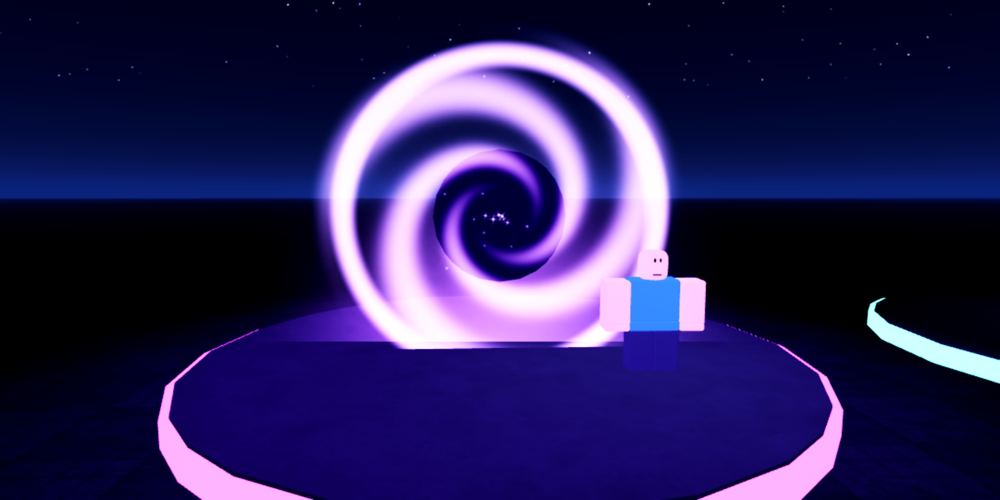
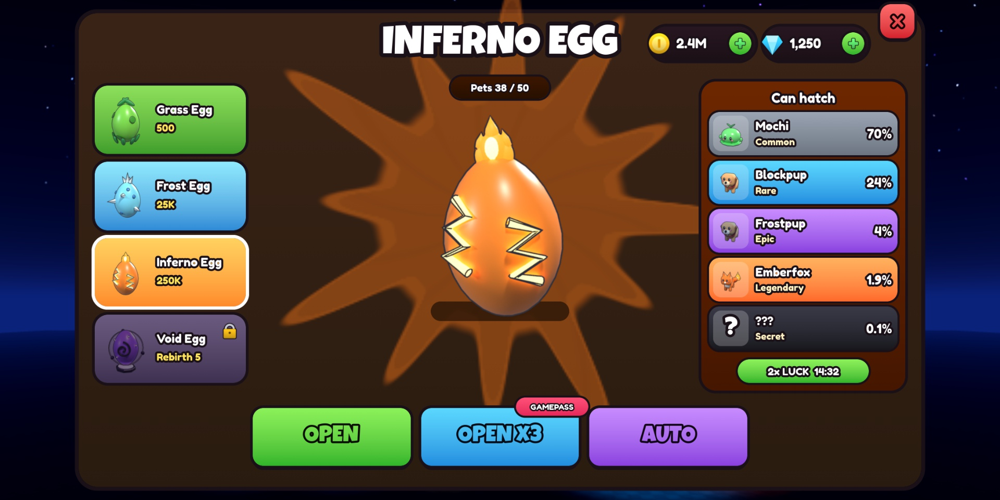

# Roblox Portfolio: Full-Stack Game Dev

UI, VFX, sound, 3D models and Luau, built for Roblox and shown running in Studio.

**Website:** [SITE URL] · **Discord:** ktfp · **Roblox:** [BizarreWasTaken](https://www.roblox.com/users/profile?username=BizarreWasTaken)

 

## Hiring boards

Each folder has a ready-to-paste post for that Discord channel and the images to attach with it.

| Board | Status | Best pieces |
|---|---|---|
| [interface](boards/interface-hiring/) | Ready | 5 game UIs built in Studio, 8 mockups |
| [vfx](boards/vfx-hiring/) | Ready | 6 layered abilities, 13 flipbooks |
| [sound](boards/sound-hiring/) | Ready | 28 original sounds, mixed onto buses |
| [modeler](boards/modeler-hiring/) | Ready | Supercar, revolver, launcher, greatsword, lounge chair, grenade, football, kart, chest |
| [graphics](boards/graphics-hiring/) | Ready | Icon set, item and pet renders, UI art |
| [scripter](boards/scripter-hiring/) | Ready, with a gap | ActionVFX, UIKit, SFXPresets modules |
| [programmer](boards/programmer-hiring/) | Ready, with a gap | Luau modules + asset-generation tools |
| [builder](boards/builder-hiring/) | Not yet | Needs a finished map |
| [animator](boards/animator-hiring/) | Not yet | Needs R15 animations |

## What's in the repo

| Folder | Contents |
|---|---|
| `ui/roblox/` | `UIKit.lua`: the shared module every Studio screen is built from |
| `designs/` | UI and model mockups (`png/` for images, `*.html` to open in a browser) |
| `vfx/` | Flipbook sheets, textures, preview GIFs, `VFXPresets.lua`, `roblox/ActionVFX.lua` |
| `sfx/` | `.ogg` (game mix) and `.wav` masters, `mix.txt`, `SFXPresets.lua` |
| `models/` | `portfolio_models.blend` with every model and an R15 reference rig |
| `assets/` | Renders, turntables, icons, uploaded Roblox asset ids |
| `review/studio/` | Screenshots taken in Roblox Studio |
| `showcase/` | `vfx-sfx.html`: every effect and every sound, playable |
| `tools/` | The generators: textures, icons, SFX, Blender render jobs |

## Rebuilding the assets

The generators need numpy; Blender's bundled Python has it.

```bash
PY=/Applications/Blender.app/Contents/Resources/5.2/python/bin/python3.13
$PY tools/make_vfx.py          # vfx/sheets, vfx/textures
$PY tools/make_icons.py assets/icons
$PY tools/make_sfx.py sfx/wav && $PY tools/make_sfx_action.py sfx/wav
```

## Rights

Every texture, icon, sound and model here was made for this portfolio; none come from store packs or sample libraries.
