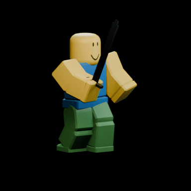
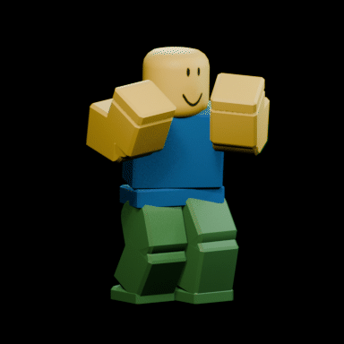
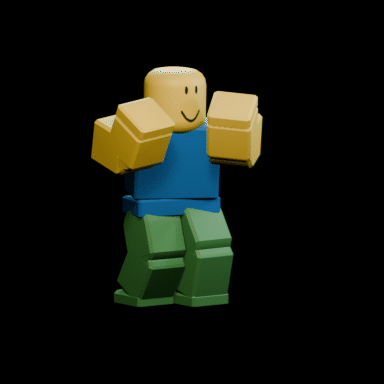
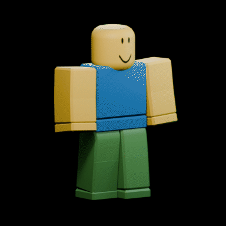
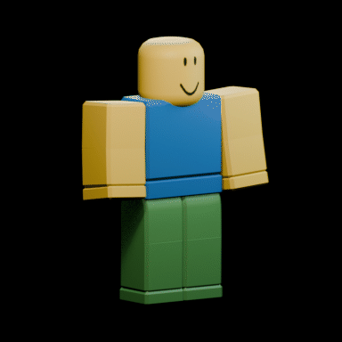
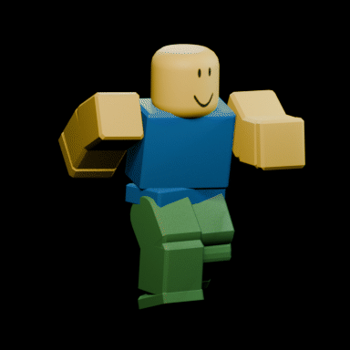

# #animator-hiring: Animator

**Status:** ready to post.

## The post

Paste this into **#animator-hiring** and attach the GIFs below.

```
**[FOR HIRE] Animator: R15 Combat, Locomotion, Emotes**
Hand-keyed R15 animations in Blender, delivered as KeyframeSequences that play in Studio.

**What I make:** sword and melee combos, punches, kicks, blocks, throws, weapon draws, runs, jumps, idles, emotes
**How they're built:** keyed on your character's actual rig, planted feet solved every frame (no sliding), clean loop seams, smooth Bezier curves
**Delivery:** KeyframeSequences in your place or .rbxm, plus the .blend and .rbxanim files

**Payment:** Robux or USD (PayPal) · per task or per project · DM for rates
**Contact:** ktfp  ·  **Roblox:** BizarreWasTaken (https://www.roblox.com/users/profile?username=BizarreWasTaken)  ·  **Portfolio:** [dawmo1.github.io](https://dawmo1.github.io)
```

## GIFs to attach

  
  

| File | What it shows |
|---|---|
| [`sword.gif`](../../animation/previews/sword.gif) | Three-hit sword combo: diagonal cut, backhand sweep, stepping overhead smash (44 frames) |
| [`punch.gif`](../../animation/previews/punch.gif) | Jab, cross with a heel pivot, dipping uppercut, back to guard (33 frames) |
| [`kick.gif`](../../animation/previews/kick.gif) | Front kick: chamber, snap to hip height, rechamber, plant (36 frames) |
| [`block.gif`](../../animation/previews/block.gif) | Snap into a high guard, absorb a hit, hold (24 frames) |
| [`grenade.gif`](../../animation/previews/grenade.gif) | Pin pull, wind-up, whip release, follow-through on the toe (32 frames) |
| [`revolver.gif`](../../animation/previews/revolver.gif) | Draw from the hip, two-hand aim, recoil and settle (36 frames) |
| [`run.gif`](../../animation/previews/run.gif) | 20-frame in-place run: contact, down, pass and up, hip/shoulder counter-twist |
| [`jump.gif`](../../animation/previews/jump.gif) | Crouch, launch, tuck, reach, compressed landing (30 frames) |
| [`victory.gif`](../../animation/previews/victory.gif) | Fist-pump jump, landing, two-beat flex (40 frames) |
| [`idle.gif`](../../animation/previews/idle.gif) | 60-frame loop: weight on one leg, breathing, head drift |

## What's behind it

- `animation/noob_anim.blend`: a classic R15 block rig with all ten actions (and the sword prop)
- `animation/animations.py`: every animation as a key table; `pose_helper.py` solves the legs so feet stay planted
- `animation/export/*.rbxanim`: the exports; `tools/rbxanim_to_luau.py` turns them into KeyframeSequences in Studio
