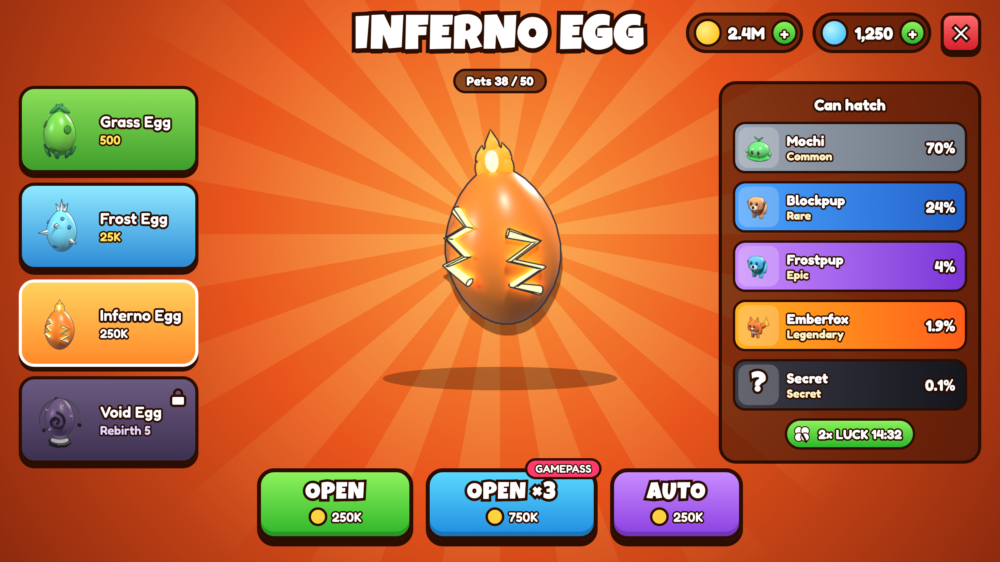
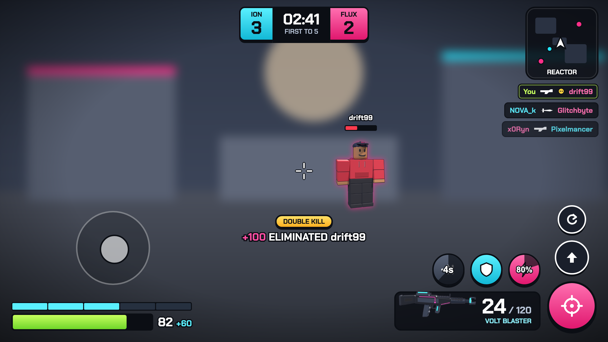
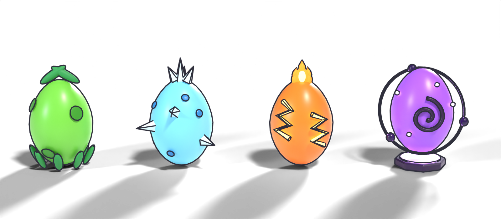
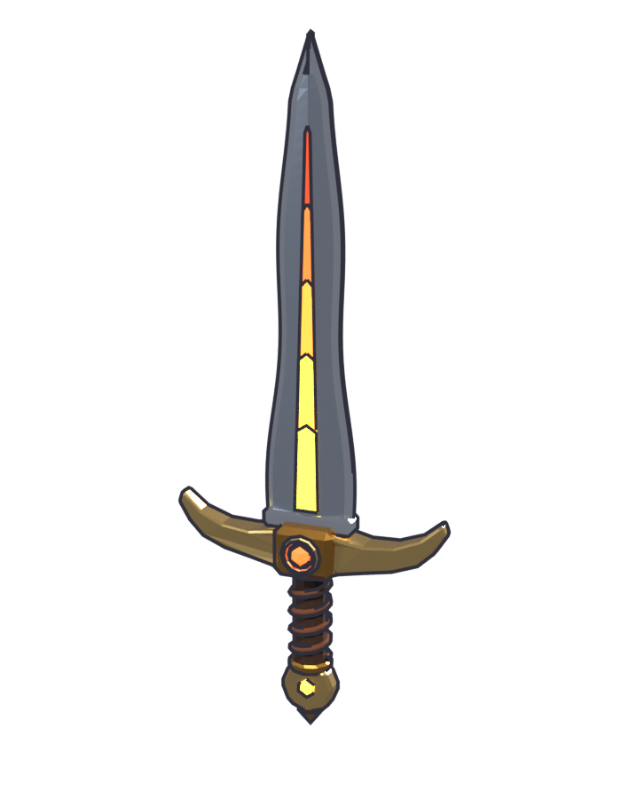
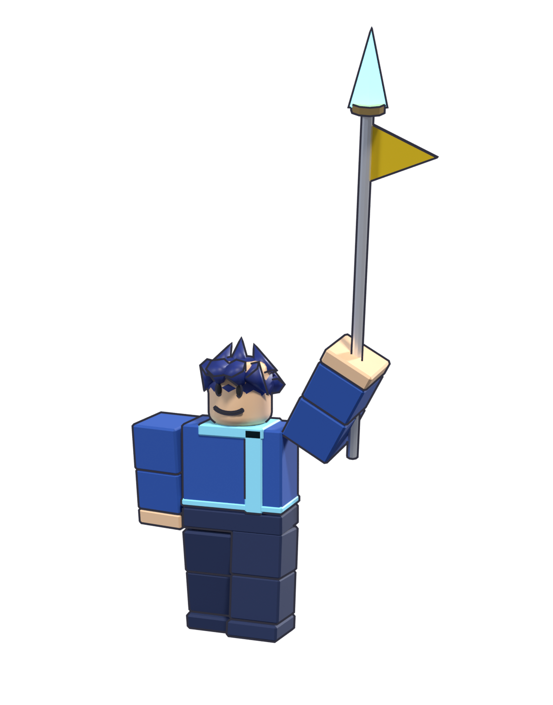

# #graphics-hiring: Graphics (icons, UI art, item art)

**Status:** ready to post.

## The post

Paste this into **#graphics-hiring** and attach the images below.

```
**[FOR HIRE] Game Graphics: Icons, Item Art, UI Art**
Chunky, readable game icons and item renders sized for Roblox UI.

**What I make:** currency and stat icons, item/pet/egg renders for shop slots, avatar headshots, UI screen art
**Format:** transparent PNG at 512 px (or what you need), consistent outline and lighting across a set
**Delivery:** PNGs + uploaded asset ids if you want them in your game

**Payment:** Robux or USD (PayPal) · per task or per project · DM for rates
**Contact:** ktfp  ·  **Roblox:** BizarreWasTaken (https://www.roblox.com/users/profile?username=BizarreWasTaken)  ·  **Portfolio:** [SITE URL]
```

## Images to attach

 
 
 

| File | What it shows |
|---|---|
| [`designs/png/EggShop.png`](../../designs/png/EggShop.png) | Egg shop art |
| [`designs/png/Main.png`](../../designs/png/Main.png) | Main HUD art |
| [`assets/renders/eggs_group.png`](../../assets/renders/eggs_group.png) | Egg set |
| [`assets/renders/pets_group.png`](../../assets/renders/pets_group.png) | Pet set |
| [`assets/renders/sword_ui.png`](../../assets/renders/sword_ui.png) | Item icon render |
| [`assets/renders/avatar_kaiyo.png`](../../assets/renders/avatar_kaiyo.png) | Avatar render |

## What's behind it

- `assets/icons/`: 12 game icons (coin, gem, cash, heart, skull, star, lock, plus, gift, sword, shield, wave) drawn from signed-distance shapes by `tools/make_icons.py`, so a new icon matches the set exactly
- Item and pet art is rendered from the 3D models in `models/`, so icons always match the in-game mesh
