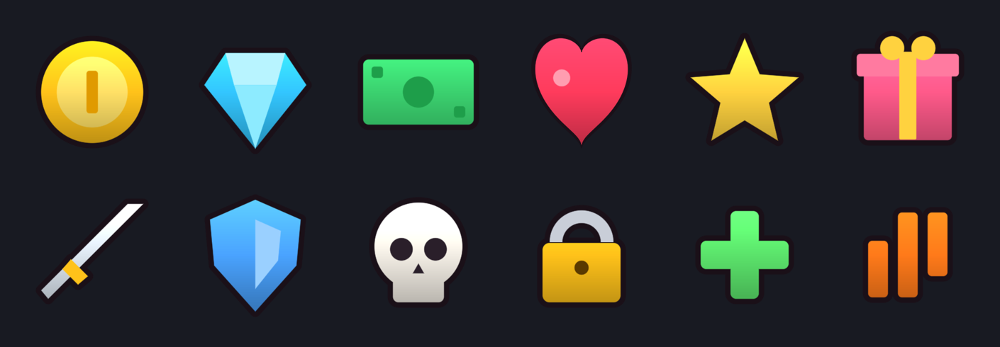
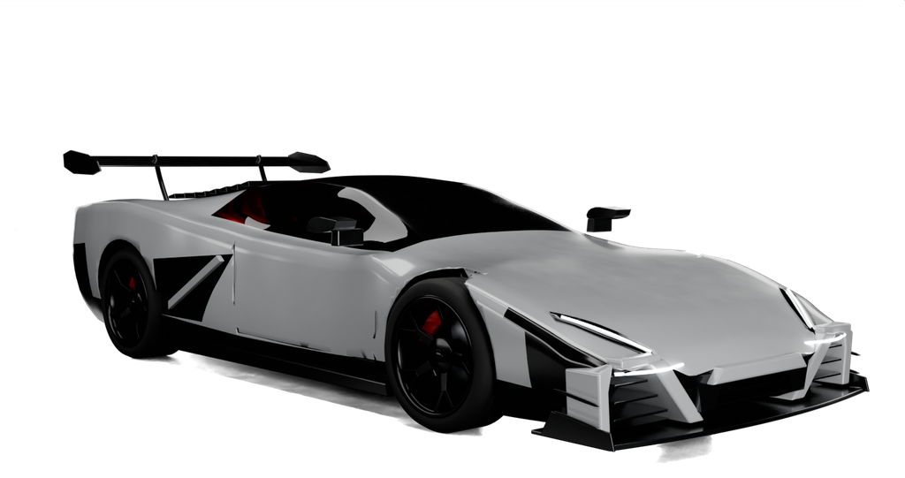
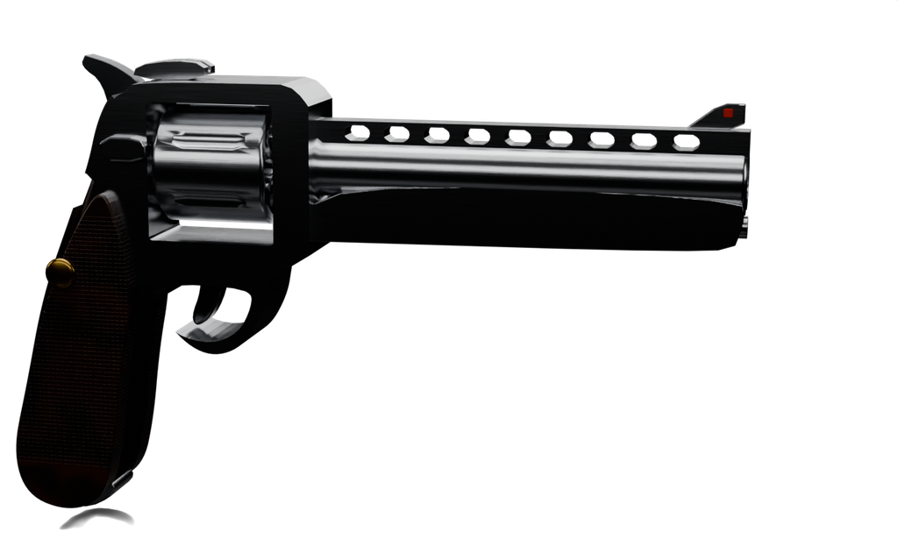
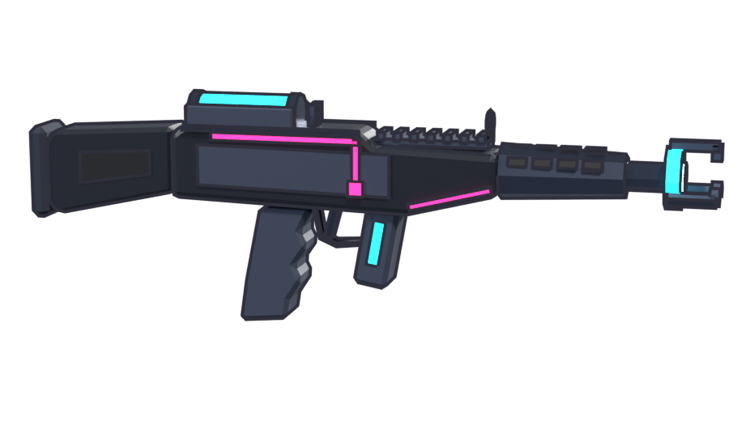
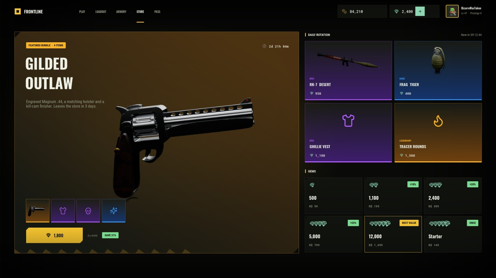

# #graphics-hiring: Graphics (icons, item art, UI art)

**Status:** ready to post.

## The post

Paste this into **#graphics-hiring** and attach the images below.

```
**[FOR HIRE] Game Graphics: Icons, Item Art, UI Art**
Readable game icons and item renders sized for Roblox UI, made to match each other as a set.

**What I make:** currency and stat icons, item renders for shop and inventory slots, UI screen art
**Format:** transparent PNG at 512 px (or what you need), consistent outline and lighting across a set
**Delivery:** PNGs, plus uploaded asset ids if you want them in your game

**Payment:** Robux or USD (PayPal) · per task or per project · DM for rates
**Contact:** ktfp  ·  **Roblox:** BizarreWasTaken (https://www.roblox.com/users/profile?username=BizarreWasTaken)  ·  **Portfolio:** [dawmo1.github.io](https://dawmo1.github.io)
```

## Images to attach


 
 

| File | What it shows |
|---|---|
| [`assets/icons/icon_set.png`](../../assets/icons/icon_set.png) | The 12-icon set: coin, gem, cash, heart, star, gift, sword, shield, skull, lock, plus, wave |
| [`ui/roblox/assets/art_*.png`](../../ui/roblox/assets/) | Transparent item art for the supercar, land yacht, mud runner, revolver, launcher and grenade |
| [`assets/renders/blaster_ui.png`](../../assets/renders/blaster_ui.png) | Shop-slot renders (also [kart](../../assets/renders/kart_ui.png) and [sword](../../assets/renders/sword_ui.png)) |
| [`site/img/ui_fl_store.jpg`](../../site/img/ui_fl_store.jpg) | The item art in use in a store screen |

## What's behind it

- `assets/icons/`: 12 icons drawn from signed-distance shapes by `tools/make_icons.py`, so a new icon matches the set exactly
- Item art is rendered from the 3D models in `models/`, so an icon always matches the in-game mesh
