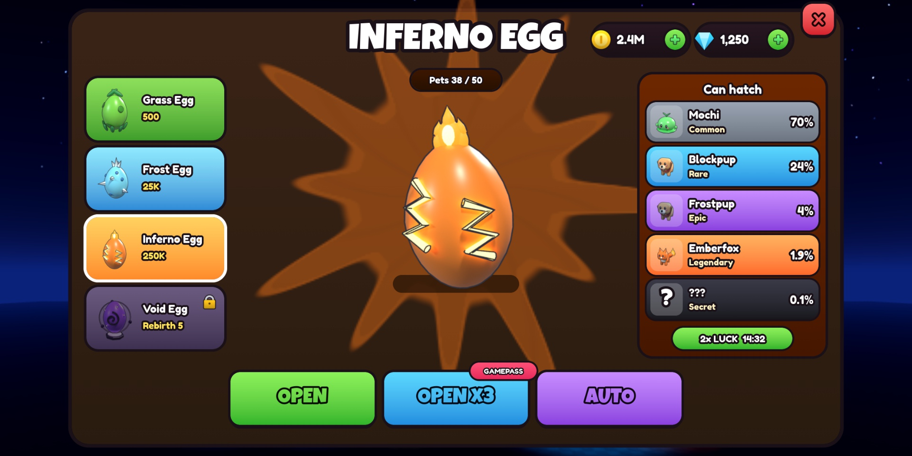
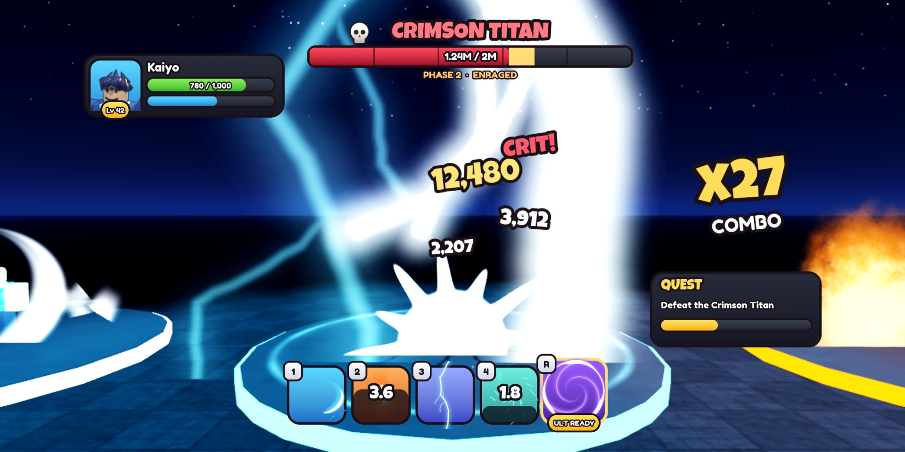
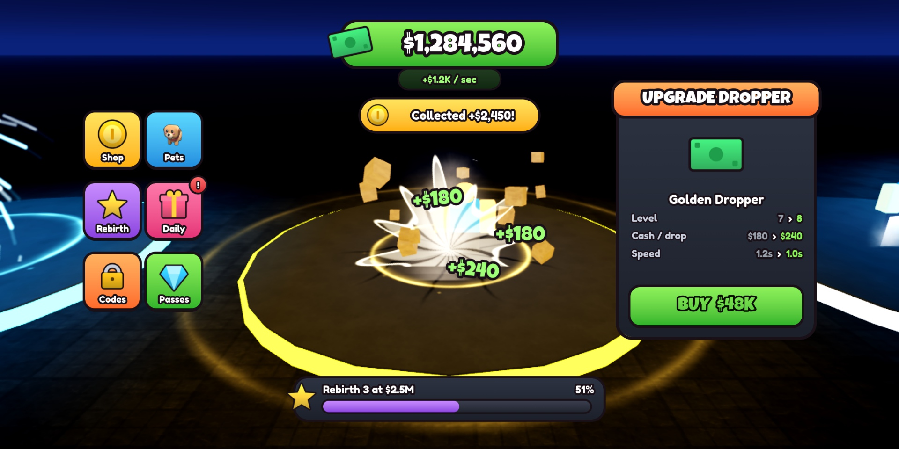
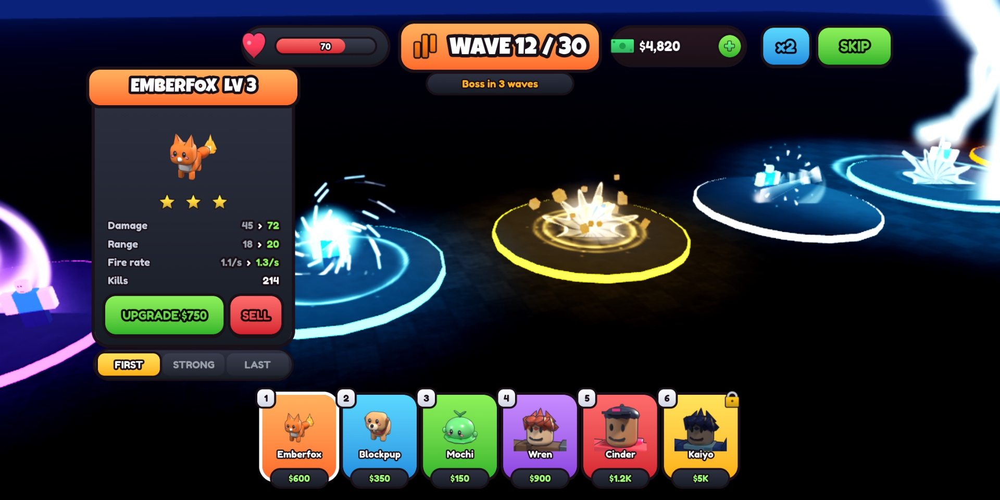
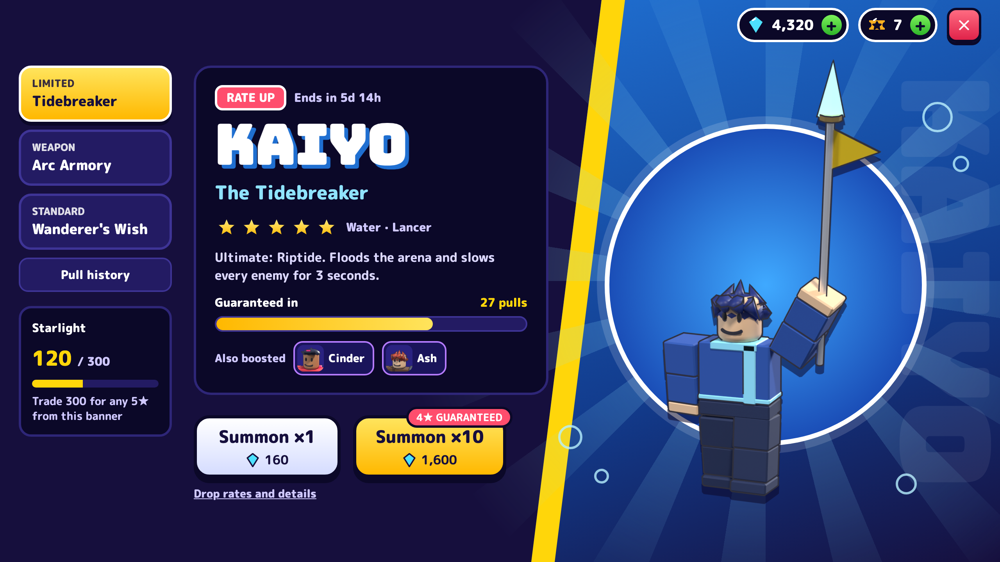
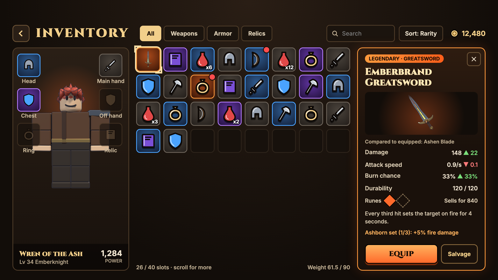
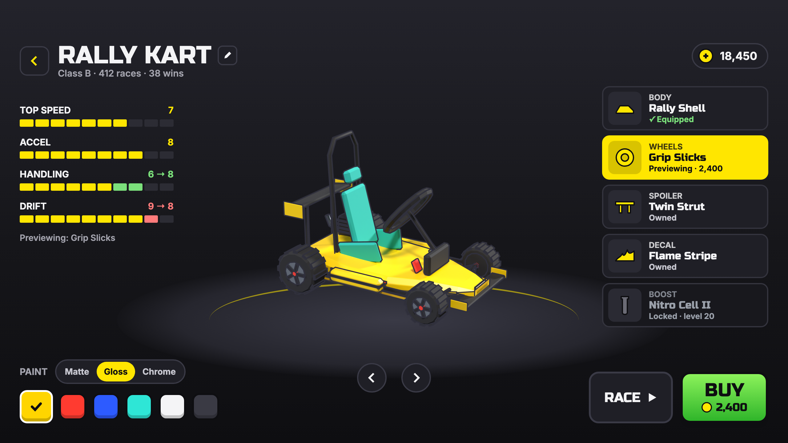
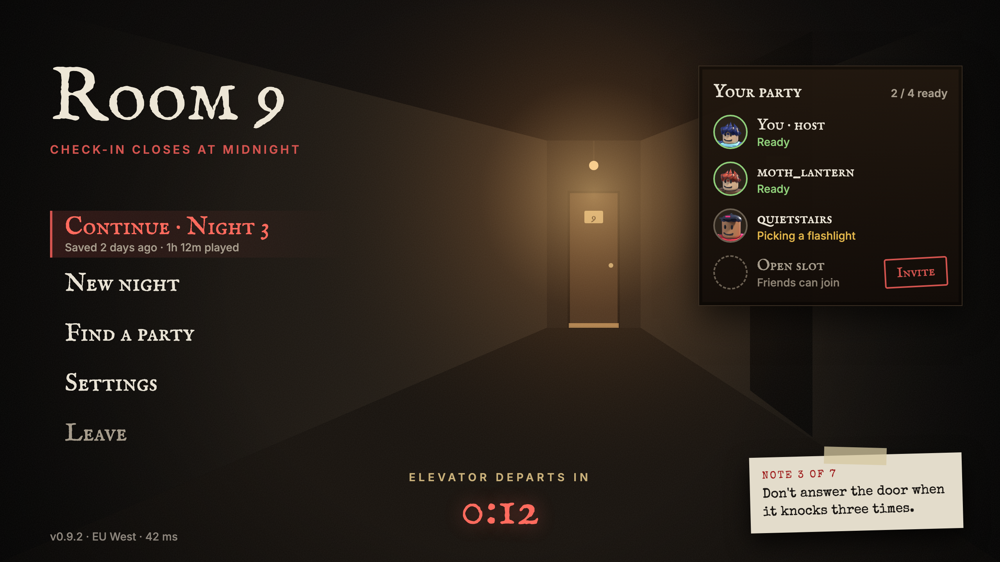

# #interface-hiring: Interface (UI) designer + implementer

**Status:** ready to post.

## The post

Paste this into **#interface-hiring** and attach the images below.

```
**[FOR HIRE] UI Designer + Implementer**
I design game UI and build it in Studio myself, so what you approve is what ships: real ScreenGuis, not just PNGs.

**What I make:** shops, egg/summon screens, HUDs, inventories, battle passes, upgrade panels
**Styles:** simulator / pet sim, tycoon, anime battler, tower defense, horror
**How it's built:** one shared UIKit module (strokes, gradients, lip buttons, hover and press tweens), scaled to fit any screen
**Delivery:** ScreenGui in your place or an .rbxm, plus source mockups

**Payment:** Robux or USD (PayPal) · per task or per project · DM for rates
**Contact:** ktfp  ·  **Roblox:** BizarreWasTaken (https://www.roblox.com/users/profile?username=BizarreWasTaken)  ·  **Portfolio:** [SITE URL]
```

## Images to attach

 
 
 
 

| File | What it shows |
|---|---|
| [`review/studio/ui_eggshop.jpg`](../../review/studio/ui_eggshop.jpg) | Egg shop, built in Studio |
| [`review/studio/ui_battle.jpg`](../../review/studio/ui_battle.jpg) | Anime battler HUD, in Studio |
| [`review/studio/ui_tycoon.jpg`](../../review/studio/ui_tycoon.jpg) | Tycoon HUD + upgrade card, in Studio |
| [`review/studio/ui_towerdefense.jpg`](../../review/studio/ui_towerdefense.jpg) | Tower defense HUD, in Studio |
| [`designs/png/Summon.png`](../../designs/png/Summon.png) | Summon banner mockup |
| [`designs/png/Inventory.png`](../../designs/png/Inventory.png) | Inventory mockup |
| [`designs/png/Garage.png`](../../designs/png/Garage.png) | Garage mockup |
| [`designs/png/Horror.png`](../../designs/png/Horror.png) | Horror HUD mockup |

## What's behind it

- `ui/roblox/UIKit.lua`: panels, stroked text, buttons with a pressable lip, bars, currency pills, hover/press juice
- Every Studio screen fits a 1280×720 design frame and scales with a UIScale, so it holds on phone and desktop
- `designs/`: the source mockups each screen was built from
