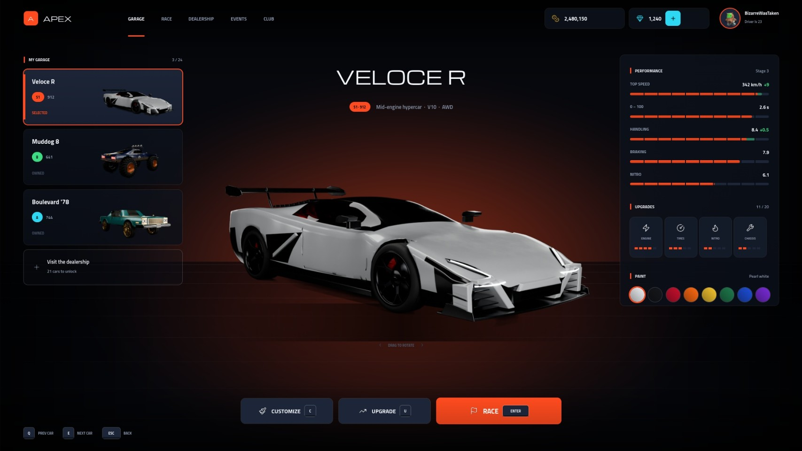
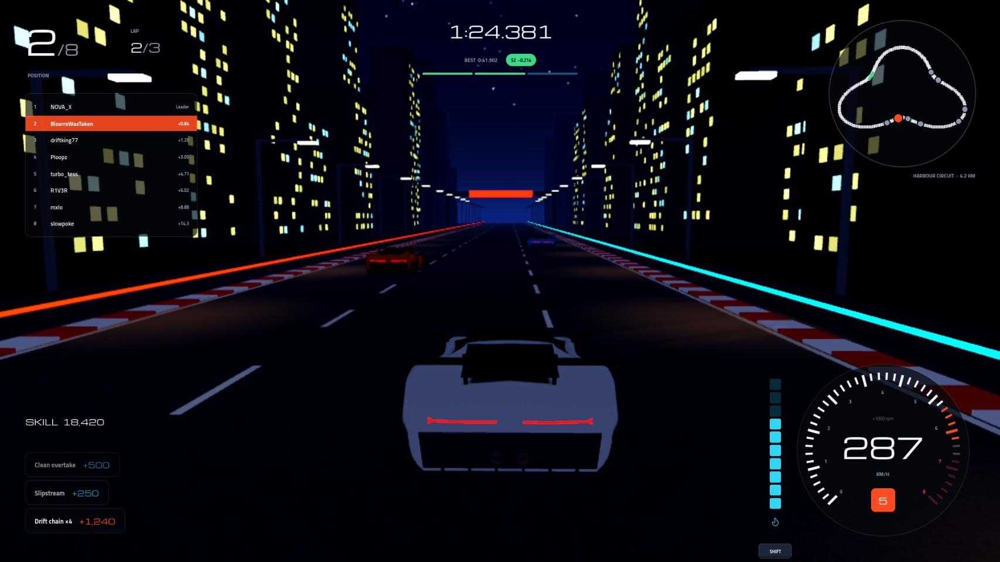
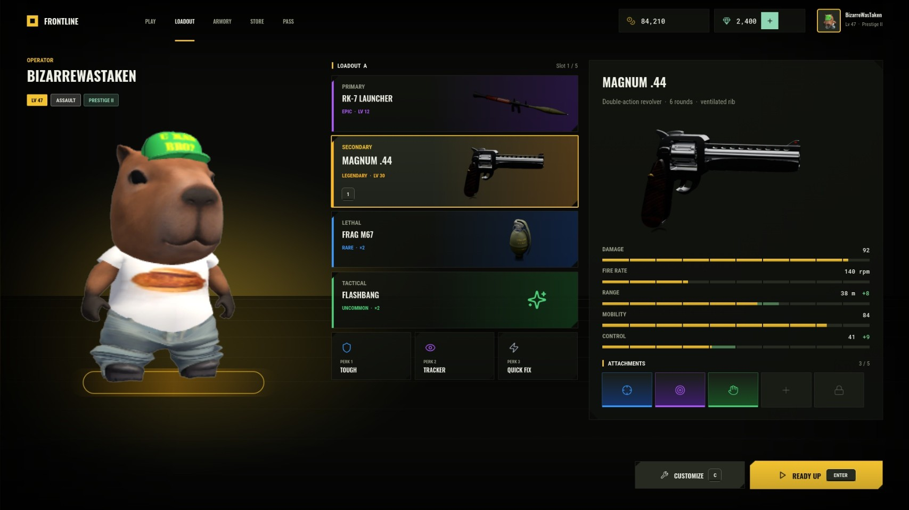
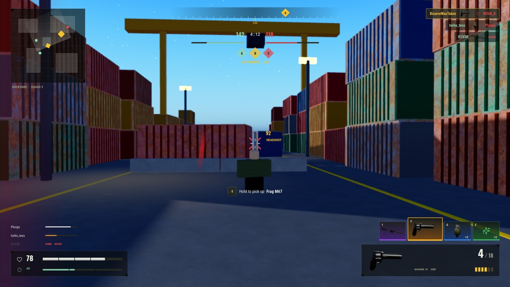
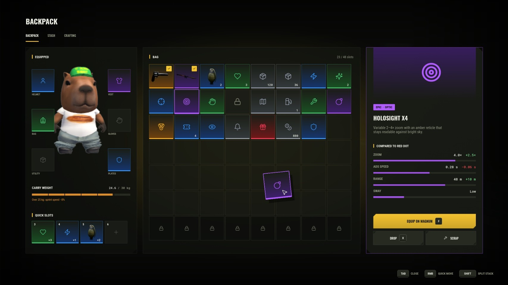
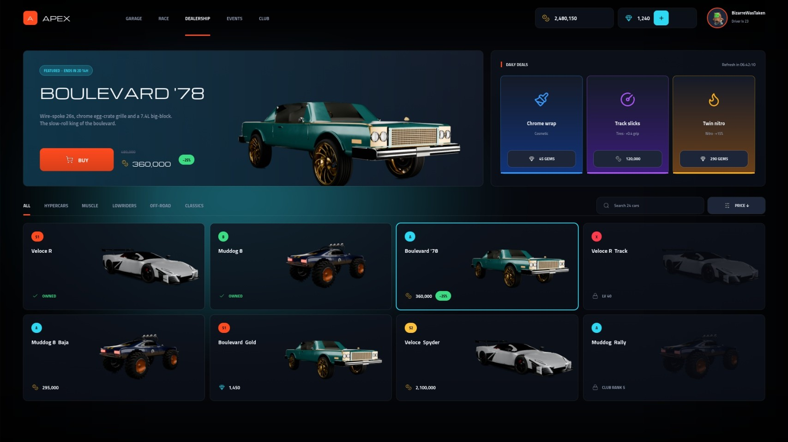
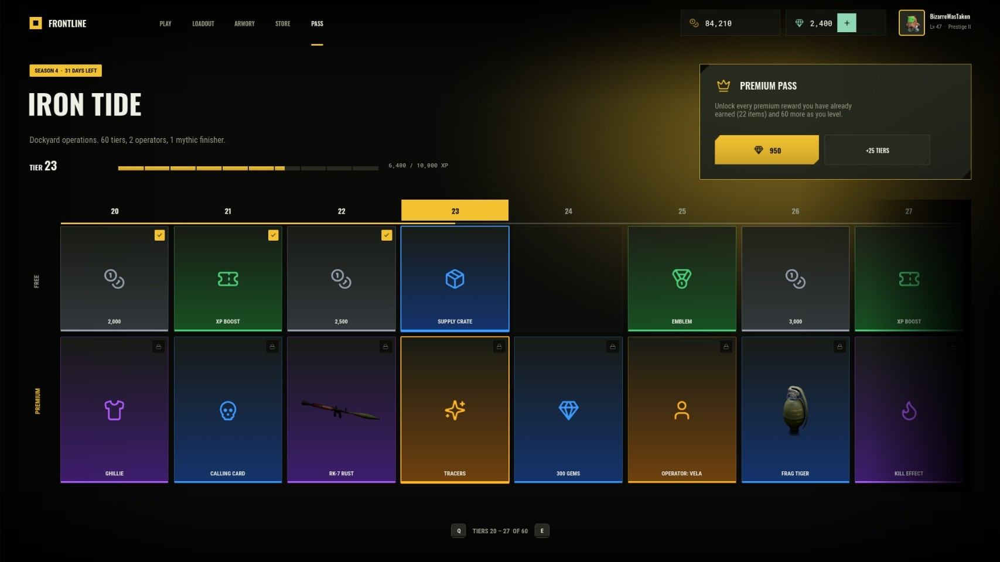
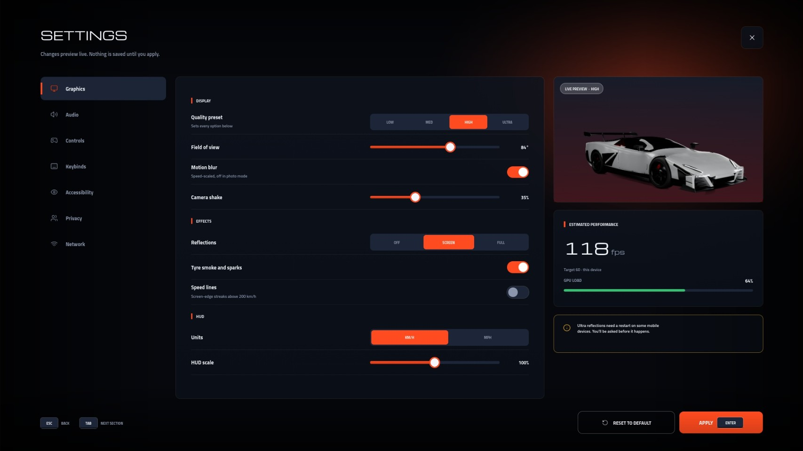

# #interface-hiring: Interface (UI) designer + implementer

**Status:** ready to post.

## The post

Paste this into **#interface-hiring** and attach the images below.

```
**[FOR HIRE] UI Designer + Implementer**
I design game UI and build it in Studio myself, so what you approve is what ships: real ScreenGuis, not just PNGs.

**What I make:** car/character select, HUDs, shops, inventories and backpacks, battle passes, daily rewards, settings, loading and results screens
**Recent work:** two full UI kits, a racing game (APEX) and a tactical shooter (FRONTLINE), 13 screens built in Studio
**How it's built:** one design system (ProKit) with shared type, colour, rarity tiers and components, laid out on a 1920×1080 canvas that scales to any screen, with real 3D avatars and model renders inside the UI
**Delivery:** ScreenGui in your place or an .rbxm, plus the module source

**Payment:** Robux or USD (PayPal) · per task or per project · DM for rates
**Contact:** ktfp  ·  **Roblox:** BizarreWasTaken (https://www.roblox.com/users/profile?username=BizarreWasTaken)  ·  **Portfolio:** [dawmo1.github.io](https://dawmo1.github.io)
```

## Images to attach

 
 
 
 

| File | What it shows |
|---|---|
| [`site/img/ui_apex_garage.jpg`](../../site/img/ui_apex_garage.jpg) | Car select: owned cars, performance with upgrade preview, upgrades, paint |
| [`site/img/ui_apex_racehud.jpg`](../../site/img/ui_apex_racehud.jpg) | Race HUD over a night circuit: position, standings, lap delta, minimap, speedo, nitro |
| [`site/img/ui_apex_dealership.jpg`](../../site/img/ui_apex_dealership.jpg) | Dealership: featured deal, daily deals, filterable catalogue |
| [`site/img/ui_apex_settings.jpg`](../../site/img/ui_apex_settings.jpg) | Settings: presets, sliders, toggles, live preview, perf estimate |
| [`site/img/ui_apex_loading.jpg`](../../site/img/ui_apex_loading.jpg) | Loading screen: event card, tip, streaming progress |
| [`site/img/ui_apex_results.jpg`](../../site/img/ui_apex_results.jpg) | Race results: classification, rewards, level-up bar |
| [`site/img/ui_fl_loadout.jpg`](../../site/img/ui_fl_loadout.jpg) | Loadout: 3D operator (the player's avatar), slots, weapon stats, attachments |
| [`site/img/ui_fl_combathud.jpg`](../../site/img/ui_fl_combathud.jpg) | Combat HUD: compass, objectives, kill feed, minimap, health, ammo, hit marker |
| [`site/img/ui_fl_backpack.jpg`](../../site/img/ui_fl_backpack.jpg) | Backpack: equipment, weight, grid with a dragged item, compare tooltip |
| [`site/img/ui_fl_store.jpg`](../../site/img/ui_fl_store.jpg) | Store: featured bundle, daily rotation, gem packs |
| [`site/img/ui_fl_battlepass.jpg`](../../site/img/ui_fl_battlepass.jpg) | Battle pass: free and premium tracks, tier progress, upsell |
| [`site/img/ui_fl_daily.jpg`](../../site/img/ui_fl_daily.jpg) | Daily rewards: 7-day streak with claimed, today and locked states |
| [`site/img/ui_fl_matchend.jpg`](../../site/img/ui_fl_matchend.jpg) | Match end: MVP card, scoreboard, XP breakdown, weapon level-up |

## What's behind it

- `ui/roblox/ProKit.lua`: the design system: two themes, panels, chamfered plates, buttons with key hints, stat bars with upgrade previews, tabs, toggles, sliders, segmented controls, rarity slots, top bar
- `ui/roblox/apex/` and `ui/roblox/frontline/`: one module per screen, each a function that builds its ScreenGui
- `ui/roblox/assets/`: the icon atlas (one 1024px sheet, Lucide icons, ISC licence) and the model renders used as item art
