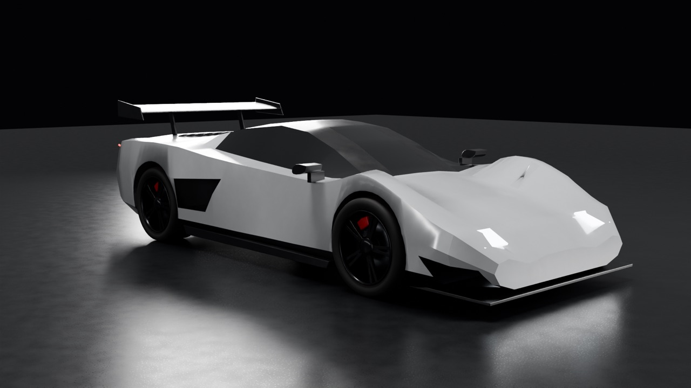
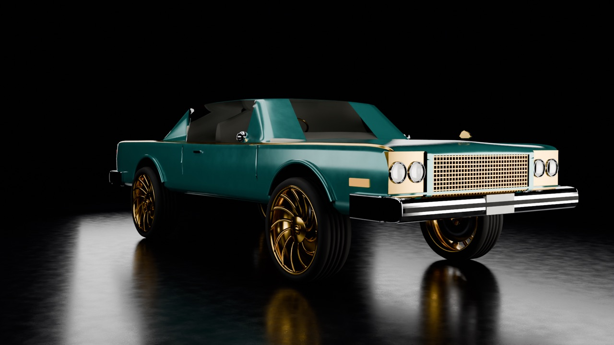
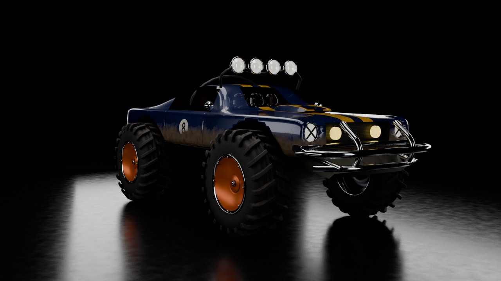
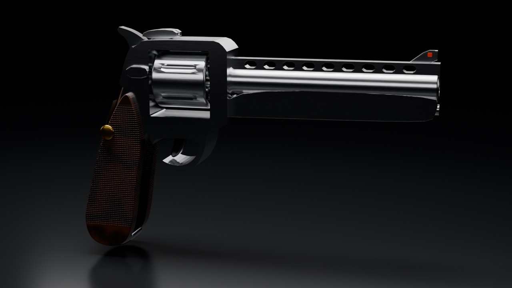
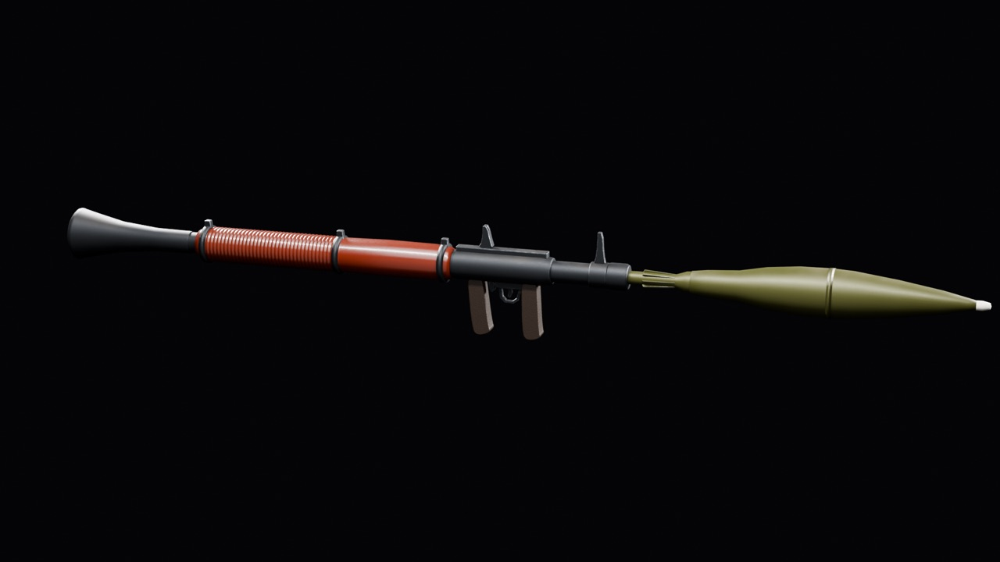
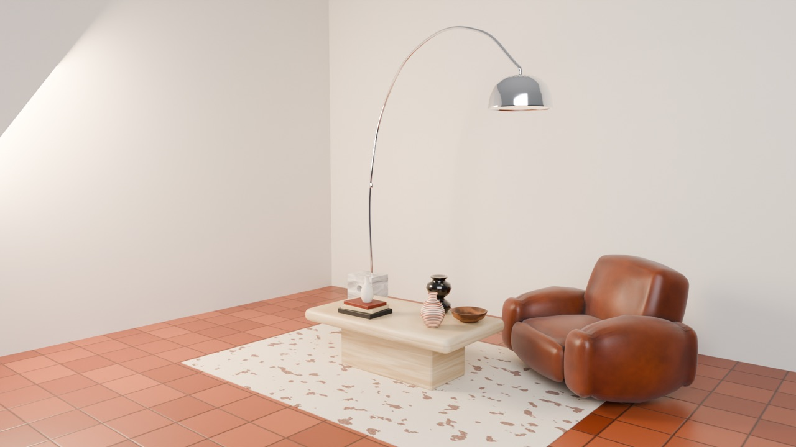
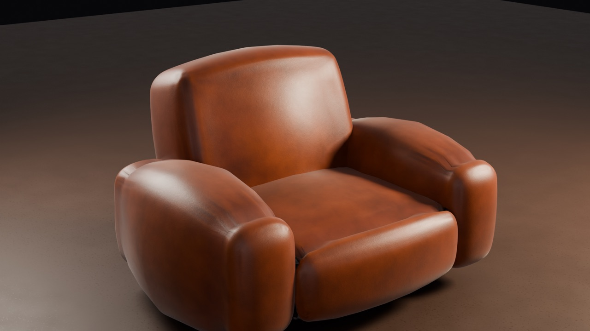
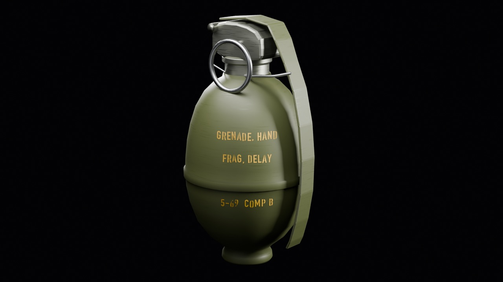

# #modeler-hiring: 3D modeler (Blender → Roblox)

**Status:** ready to post.

## The post

Paste this into **#modeler-hiring** and attach the images below.

```
**[FOR HIRE] 3D Modeler: Vehicles, Weapons, Props, Furniture**
Realistic, game-ready models built in Blender at real-world scale and imported to Studio as MeshParts.

**What I make:** cars and vehicles, weapons, props and furniture, interior sets
**Every model comes with:** one MeshPart under 20k triangles, baked colour, metal, roughness and normal maps for SurfaceAppearance, Studio-checked scale
**Delivery:** .fbx ready for Studio import plus the texture maps and the .blend

**Payment:** Robux or USD (PayPal) · per task or per project · DM for rates
**Contact:** ktfp  ·  **Roblox:** BizarreWasTaken (https://www.roblox.com/users/profile?username=BizarreWasTaken)  ·  **Portfolio:** [dawmo1.github.io](https://dawmo1.github.io)
```

## Images to attach

 
 
 
 

| File | What it shows |
|---|---|
| [`site/img/supercar_hero.jpg`](../../site/img/supercar_hero.jpg) | Supercar (also [front](../../site/img/supercar_front.jpg) and [rear](../../site/img/supercar_rear.jpg)) |
| [`site/img/donk_hero.jpg`](../../site/img/donk_hero.jpg) | 70s land yacht on gold turbine rims (also [side](../../site/img/donk_side.jpg)) |
| [`site/img/mudrunner_hero.jpg`](../../site/img/mudrunner_hero.jpg) | Mud runner off-roader (also [rear](../../site/img/mudrunner_rear.jpg)) |
| [`site/img/revolver_hero.jpg`](../../site/img/revolver_hero.jpg) | Revolver (also [detail](../../site/img/revolver_detail.jpg)) |
| [`site/img/launcher_hero.jpg`](../../site/img/launcher_hero.jpg) | Rocket launcher (also [detail](../../site/img/launcher_detail.jpg)) |
| [`site/img/grenade_hero.jpg`](../../site/img/grenade_hero.jpg) | Grenade (also [detail](../../site/img/grenade_detail.jpg)) |
| [`site/img/decor_hero.jpg`](../../site/img/decor_hero.jpg) | Living-room set (also [table](../../site/img/decor_table.jpg)) |
| [`site/img/lounge_chair_hero.jpg`](../../site/img/lounge_chair_hero.jpg) | Lounge chair (also [detail](../../site/img/lounge_chair_detail.jpg)) |
| [`site/img/football_hero.jpg`](../../site/img/football_hero.jpg) | Football |
| [`site/img/carbine_hero.jpg`](../../site/img/carbine_hero.jpg), [`greatsword_hero.jpg`](../../site/img/greatsword_hero.jpg), [`kart_hero.jpg`](../../site/img/kart_hero.jpg), [`chest_open_hero.jpg`](../../site/img/chest_open_hero.jpg), [`blaster_hero.jpg`](../../site/img/blaster_hero.jpg) | The first PBR batch: carbine, greatsword, kart, loot chest, blaster |
| [`assets/turntables/`](../../assets/turntables/) | Turntable GIFs of the kart, blaster, sword and chest |

## What's behind it

- `models/<name>/`: game-ready `.fbx` plus base colour / metallic / roughness / normal maps per model
- `models/portfolio_models_v2.blend`: the vehicles, weapons and furniture; `models/portfolio_models_pbr.blend`: the first PBR batch
- Renders: Cycles with a shadow catcher; turntables in `assets/turntables/`
