# #modeler-hiring: 3D modeler (Blender → Roblox)

**Status:** ready to post.

## The post

Paste this into **#modeler-hiring** and attach the images below.

```
**[FOR HIRE] 3D Modeler: Weapons, Props, Vehicles, Pets**
Stylised low-poly models built in Blender at Roblox scale, checked against an R15 rig before export.

**What I make:** realistic or stylized weapons, props, vehicles; pets and eggs
**Every model comes with:** one MeshPart under 20k tris, baked 1024 PBR maps for SurfaceAppearance, stud-scale check next to an R15 rig, renders
**Delivery:** .fbx/.obj ready for Studio import, plus the .blend

**Payment:** Robux or USD (PayPal) · per task or per project · DM for rates
**Contact:** ktfp  ·  **Roblox:** BizarreWasTaken (https://www.roblox.com/users/profile?username=BizarreWasTaken)  ·  **Portfolio:** [SITE URL]
```

## Images to attach

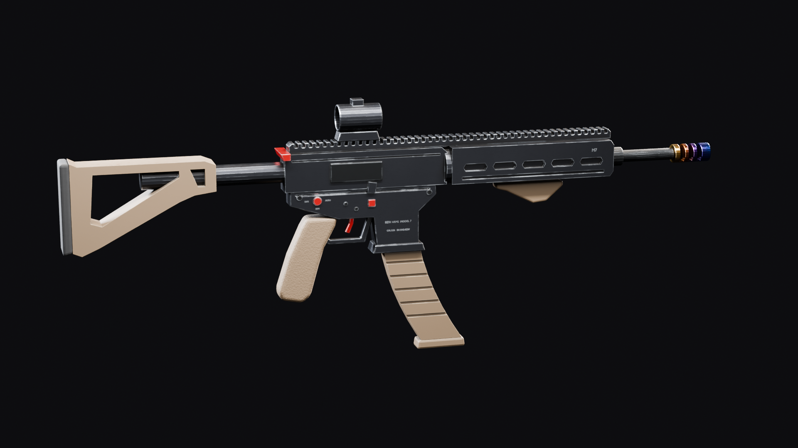 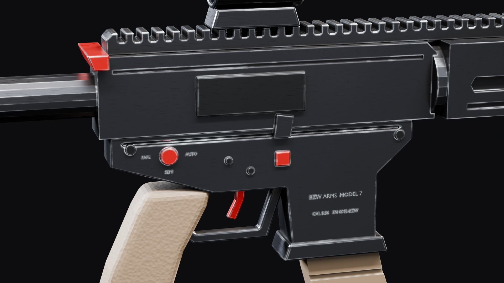
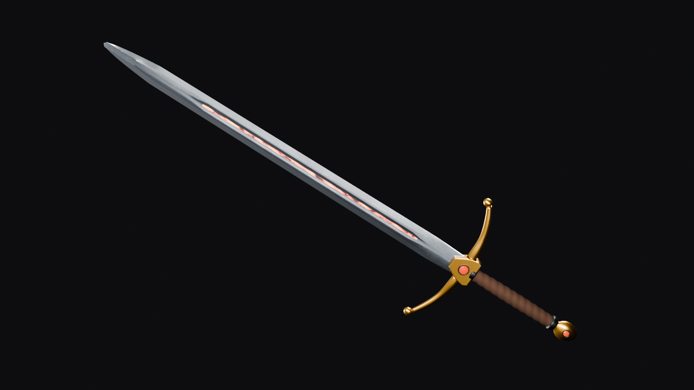 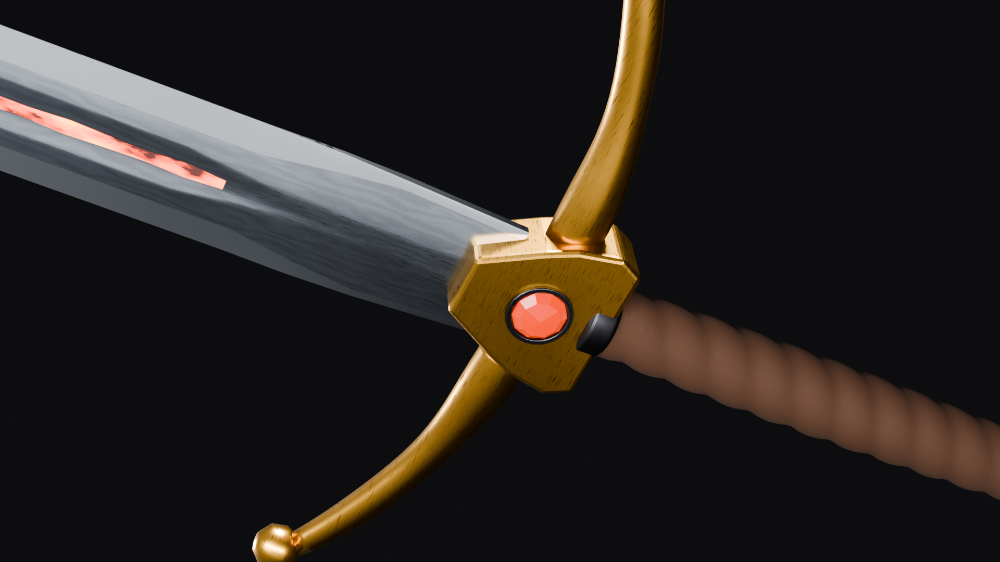
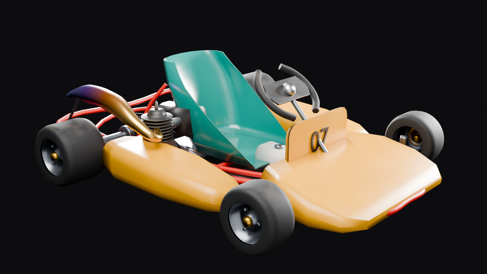 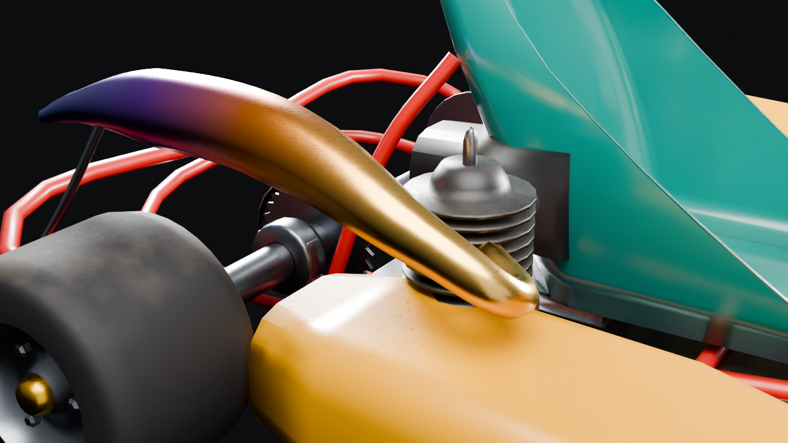
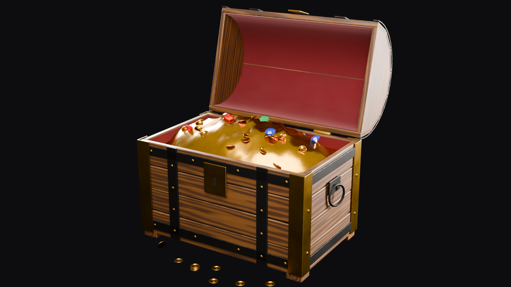 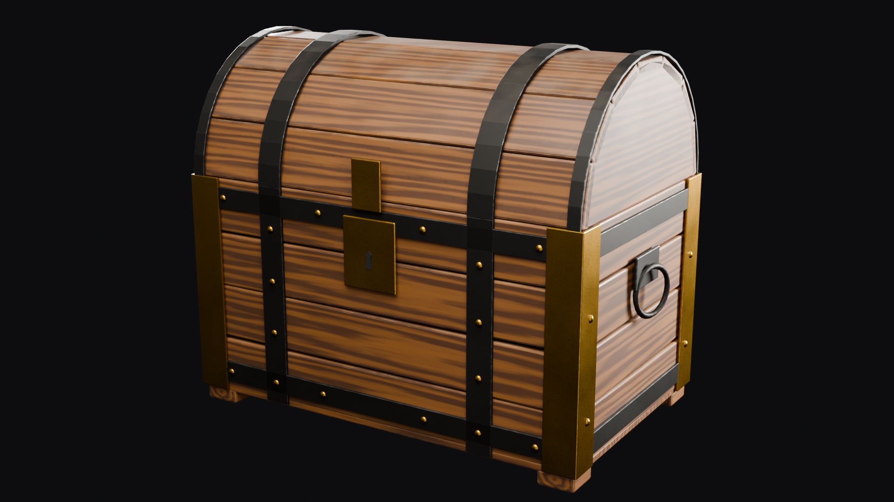
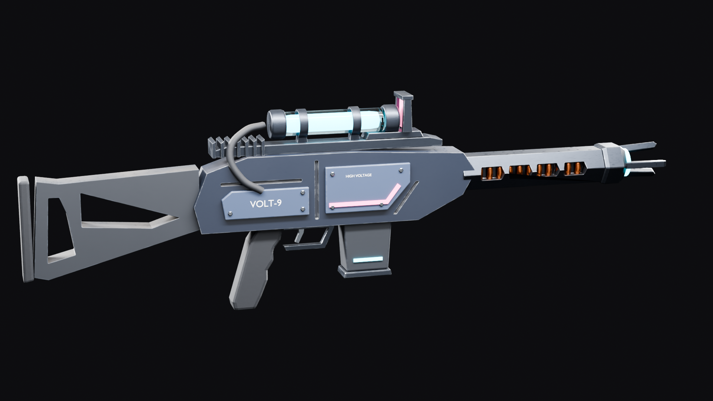 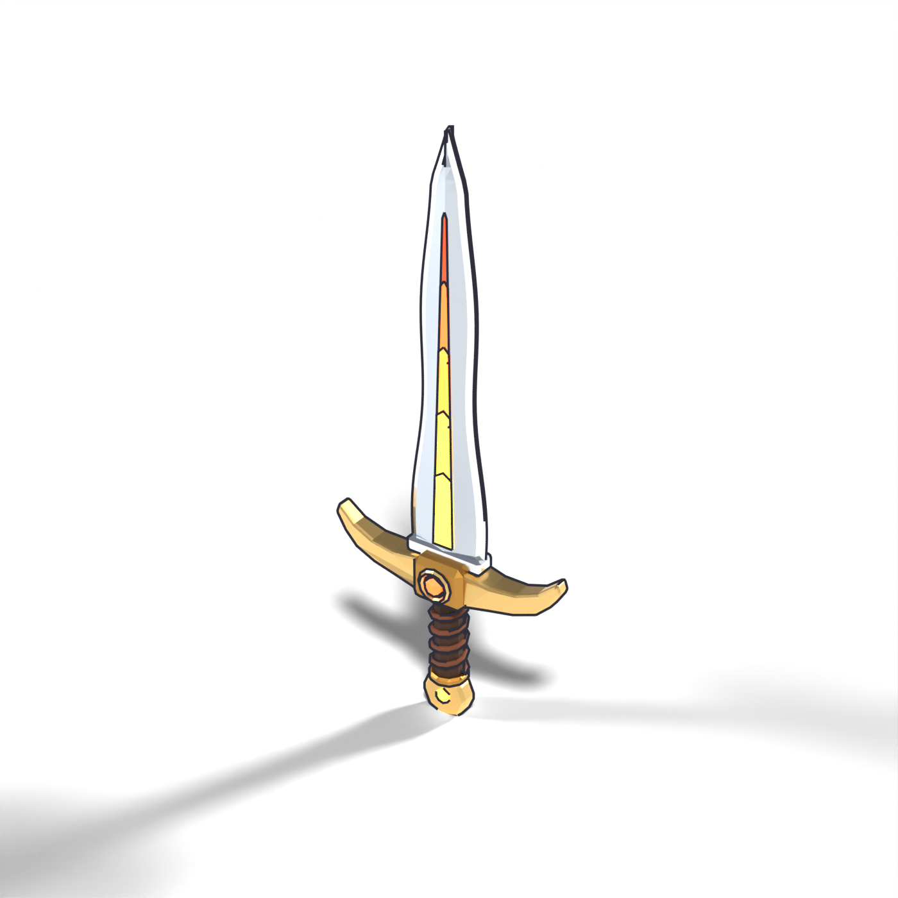
 
 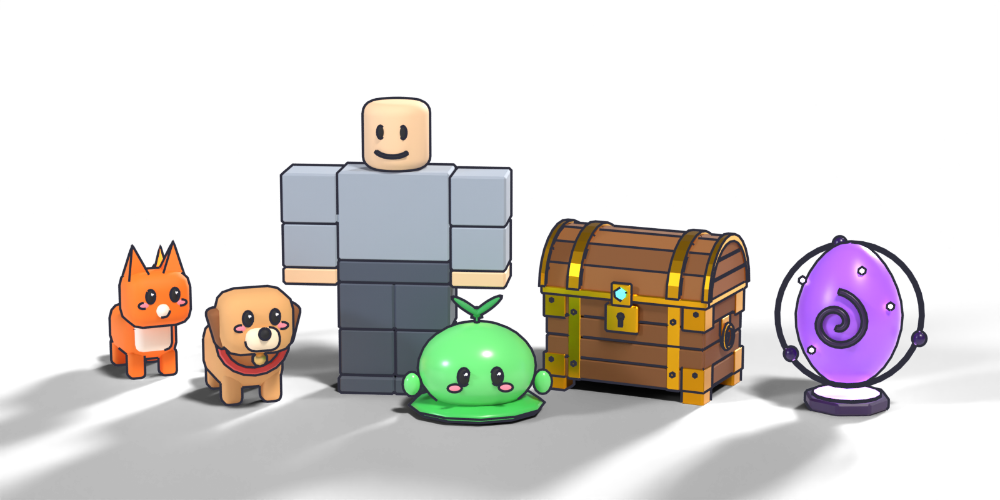
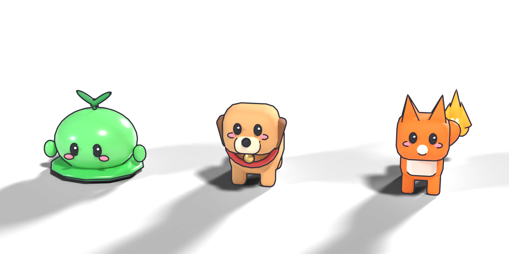 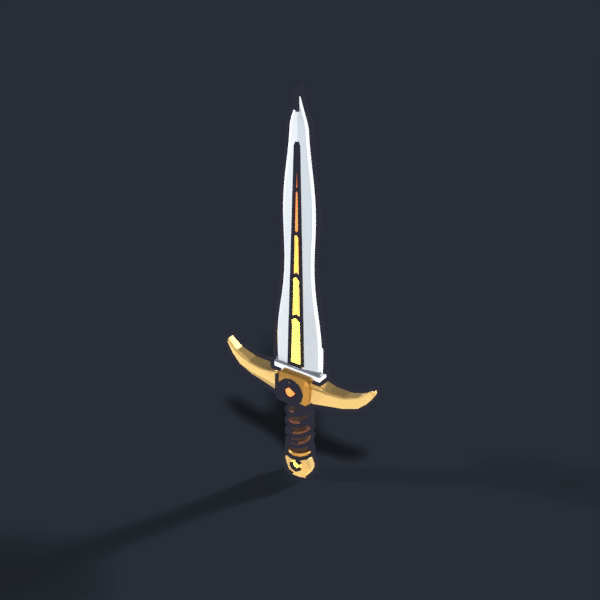
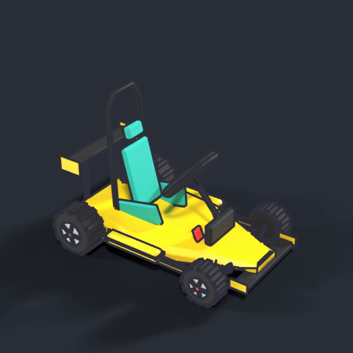

| File | What it shows |
|---|---|
| [`assets/renders/carbine_hero.png`](../../assets/renders/carbine_hero.png) | Carbine, realistic PBR |
| [`assets/renders/carbine_detail.png`](../../assets/renders/carbine_detail.png) | Carbine receiver close-up |
| [`assets/renders/greatsword_hero.png`](../../assets/renders/greatsword_hero.png) | Greatsword, realistic PBR |
| [`assets/renders/greatsword_detail.png`](../../assets/renders/greatsword_detail.png) | Greatsword hilt close-up |
| [`assets/renders/kart_hero.png`](../../assets/renders/kart_hero.png) | Racing kart, realistic PBR |
| [`assets/renders/kart_detail.png`](../../assets/renders/kart_detail.png) | Kart engine close-up |
| [`assets/renders/chest_open_hero.png`](../../assets/renders/chest_open_hero.png) | Loot chest open, realistic PBR |
| [`assets/renders/chest_closed_hero.png`](../../assets/renders/chest_closed_hero.png) | Loot chest closed |
| [`assets/renders/blaster_hero.png`](../../assets/renders/blaster_hero.png) | VOLT-9 blaster, realistic PBR |
| [`assets/renders/sword_hero.png`](../../assets/renders/sword_hero.png) | Greatsword, stylized |
| [`assets/renders/chest_open_hero.png`](../../assets/renders/chest_open_hero.png) | Loot chest, open |
| [`assets/renders/kart_hero.png`](../../assets/renders/kart_hero.png) | Kart |
| [`assets/renders/blaster_hero.png`](../../assets/renders/blaster_hero.png) | Blaster |
| [`assets/renders/scale_lineup.png`](../../assets/renders/scale_lineup.png) | Scale check against an R15 rig |
| [`assets/renders/pets_group.png`](../../assets/renders/pets_group.png) | Pets |
| [`assets/turntables/sword_turntable.gif`](../../assets/turntables/sword_turntable.gif) | Sword turntable |
| [`assets/turntables/kart_turntable.gif`](../../assets/turntables/kart_turntable.gif) | Kart turntable |

## What's behind it

- `models/<name>/`: game-ready `.fbx` + basecolor / metallic / roughness / normal maps per model
- `models/portfolio_models.blend`: every model, plus a procedural R15 reference rig (5.2 studs tall)
- Renders: Cycles with outline lines and a shadow catcher; turntables in `assets/turntables/`
