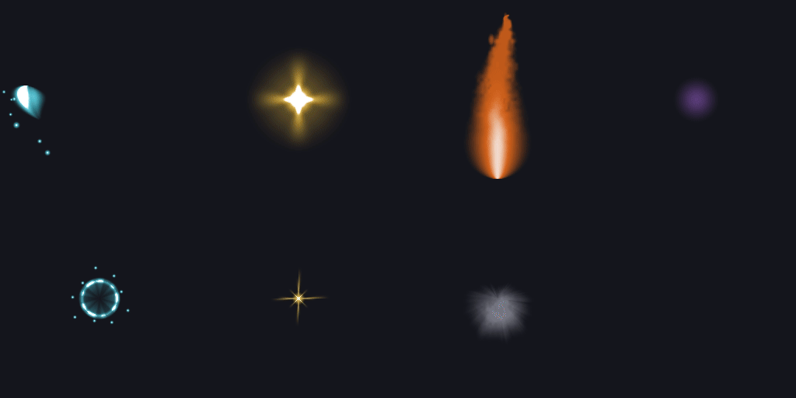
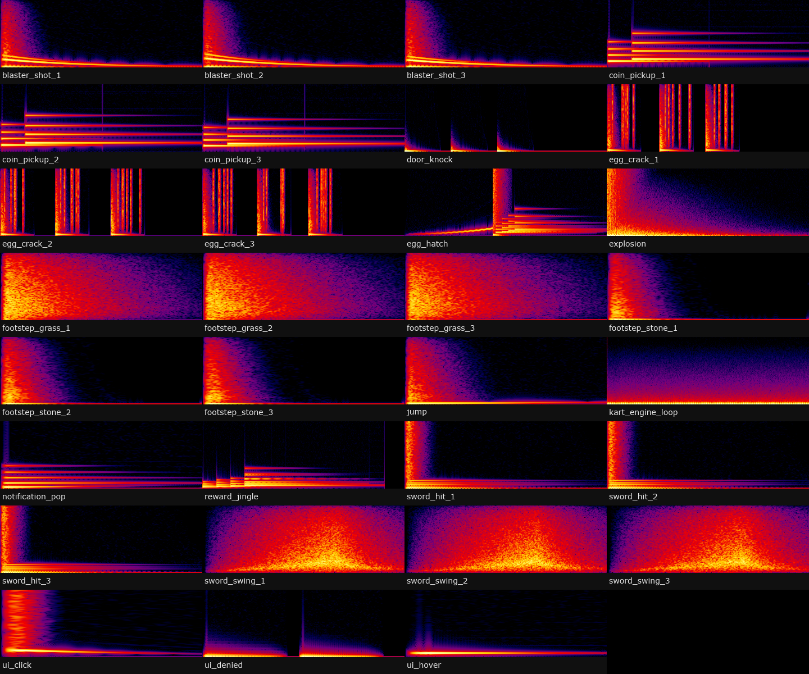

# #programmer-hiring: Programmer (Luau + tools)

**Status:** ready to post; see the note at the bottom first.

## The post

Paste this into **#programmer-hiring** and attach the images below.

```
**[FOR HIRE] Programmer: Luau Systems + Asset Tooling**
I write Luau game modules and the tools around them, so assets come out of a script instead of being made by hand.

**Luau:** ability VFX system, UI kit, audio module with buses and variations (all `--!strict`)
**Tooling:** Python generators for flipbook textures, icons and synthesised SFX; headless Blender render pipeline; template renderer for UI mockups
**Delivery:** code in your place or repo, with comments on the why

**Payment:** Robux or USD (PayPal) · per task or per project · DM for rates
**Contact:** ktfp  ·  **Roblox:** BizarreWasTaken (https://www.roblox.com/users/profile?username=BizarreWasTaken)  ·  **Portfolio:** [dawmo1.github.io](https://dawmo1.github.io)
```

## Images to attach

 

| File | What it shows |
|---|---|
| [`vfx/previews/vfx_reel.gif`](../../vfx/previews/vfx_reel.gif) | Flipbooks generated by make_vfx.py |
| [`sfx/_check/all.png`](../../sfx/_check/all.png) | Sounds synthesised by make_sfx.py |

## What's behind it

- `tools/make_vfx.py`: value noise + midpoint-displacement lightning → 4×4 flipbooks
- `tools/make_sfx.py` / `make_sfx_action.py`: biquad filters, envelopes, convolution reverb, round-robin takes
- `tools/bg_render.py`: Blender background render jobs (stills, turntables)
- Luau modules: see the scripter folder

> **Before posting:** Same gap as scripter: no persistent-data or networking system yet.
