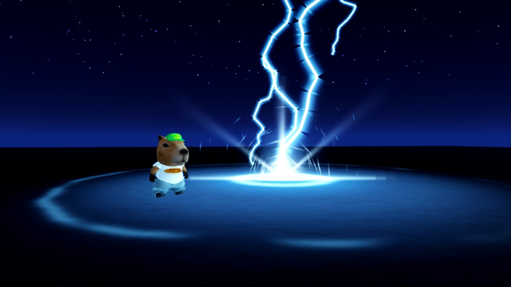
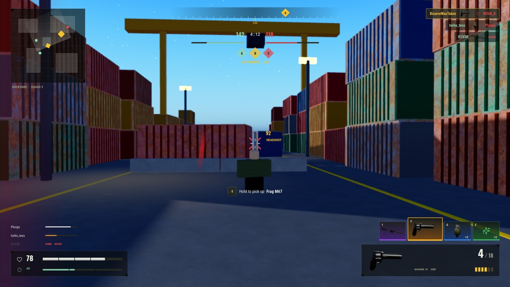

# #scripter-hiring: Scripter (Luau)

**Status:** ready to post; see the note at the bottom first.

## The post

Paste this into **#scripter-hiring** and attach the images below.

```
**[FOR HIRE] Scripter: Luau Modules for Combat, VFX, UI and Audio**
Typed (`--!strict`) Luau ModuleScripts that a team can call in one line and read later.

**Shown in my portfolio:** an ability VFX module (5 layered abilities), a UI design system used to build 13 game screens, an audio module with mixing buses and round-robin sounds
**I write:** client/server split with RemoteEvents, cleanup with Debris, no leaked instances
**Delivery:** ModuleScripts in your place or as files, with usage notes at the top

**Payment:** Robux or USD (PayPal) · per task or per project · DM for rates
**Contact:** ktfp  ·  **Roblox:** BizarreWasTaken (https://www.roblox.com/users/profile?username=BizarreWasTaken)  ·  **Portfolio:** [dawmo1.github.io](https://dawmo1.github.io)
```

## Images to attach

 

| File | What it shows |
|---|---|
| [`site/img/vfx_storm.jpg`](../../site/img/vfx_storm.jpg) | `ShowcaseVFX.storm(cframe)` in Studio |
| [`site/img/ui_fl_combathud.jpg`](../../site/img/ui_fl_combathud.jpg) | Combat HUD built from the ProKit design system |

## What's behind it

- `vfx/roblox/ShowcaseVFX.lua` (261 lines) and `vfx/roblox/ActionVFX.lua` (365 lines): abilities, emitter builder, segmented lightning, camera shake, debris, light flashes
- `ui/roblox/ProKit.lua` (463 lines) plus 13 screen modules in `ui/roblox/apex/` and `ui/roblox/frontline/`
- `sfx/SFXPresets.lua` (123 lines), `vfx/VFXPresets.lua` (173 lines)

> **Before posting:** Not shown yet: game systems such as DataStore saving, server-checked remotes, or a round/match loop. Most scripter posts ask for these; build one before posting here.
