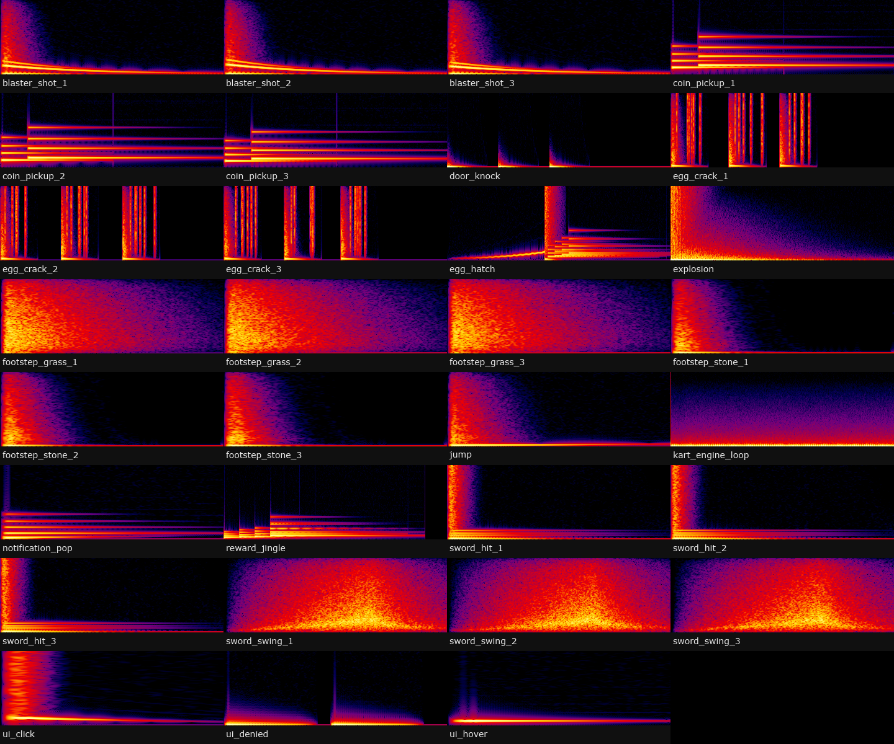

# #sound-hiring: Sound designer

**Status:** ready to post.

## The post

Paste this into **#sound-hiring** and attach the images below.

```
**[FOR HIRE] Sound Designer: UI, Combat, Abilities, Ambience**
Original game SFX, made from scratch (no library samples, so no licensing questions).

**What I make:** UI clicks/hovers/denies, rewards and hatches, combat swings and hits, ability casts and impacts, footsteps, engine loops
**Mixed for Roblox:** levels baked per sound, round-robin variations so repeats don't sound copy-pasted, SoundGroup buses (UI / SFX / Vehicle / Ambience) for settings sliders
**Delivery:** .ogg files (uploaded or raw), plus a ModuleScript to play them

**Payment:** Robux or USD (PayPal) · per task or per project · DM for rates
**Contact:** ktfp  ·  **Roblox:** BizarreWasTaken (https://www.roblox.com/users/profile?username=BizarreWasTaken)  ·  **Portfolio:** [dawmo1.github.io](https://dawmo1.github.io)
```

## Images to attach



| File | What it shows |
|---|---|
| [`sfx/_check/all.png`](../../sfx/_check/all.png) | Spectrograms of the sound set |

## What's behind it

- Listen on the showcase page: `showcase/vfx-sfx.html` (press a sound twice to hear its next variation)
- `sfx/ogg/`: 48 files (28 sounds, the frequent ones with ×3 variations); `sfx/mix.txt` is the mix table
- `sfx/SFXPresets.lua`: buses, random variation pick, 3D sounds, seamless engine loop with pitch by speed
