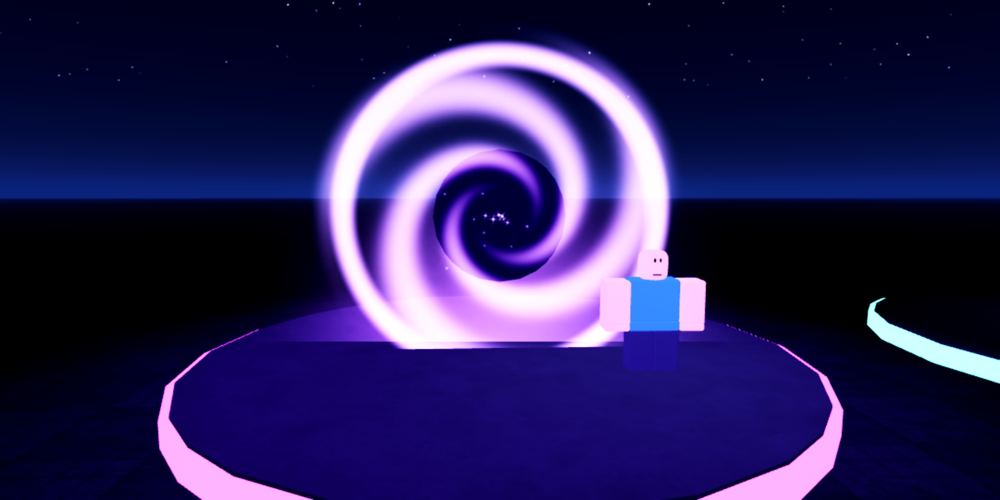
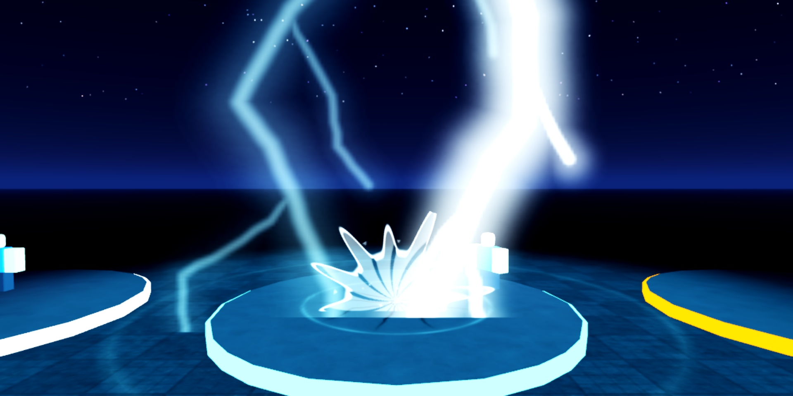
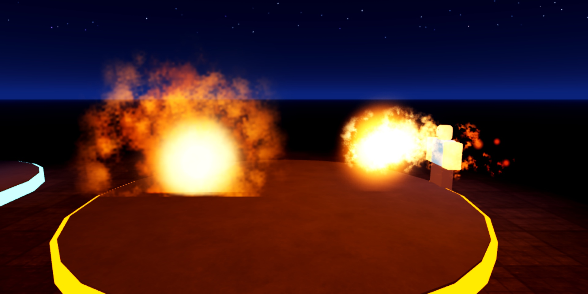
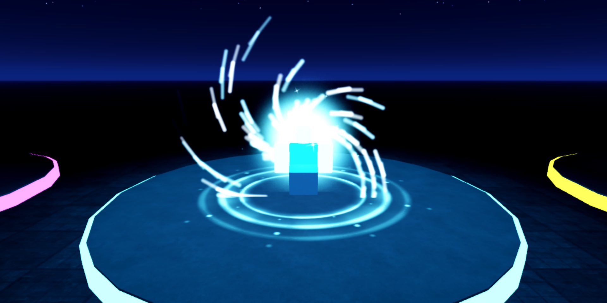
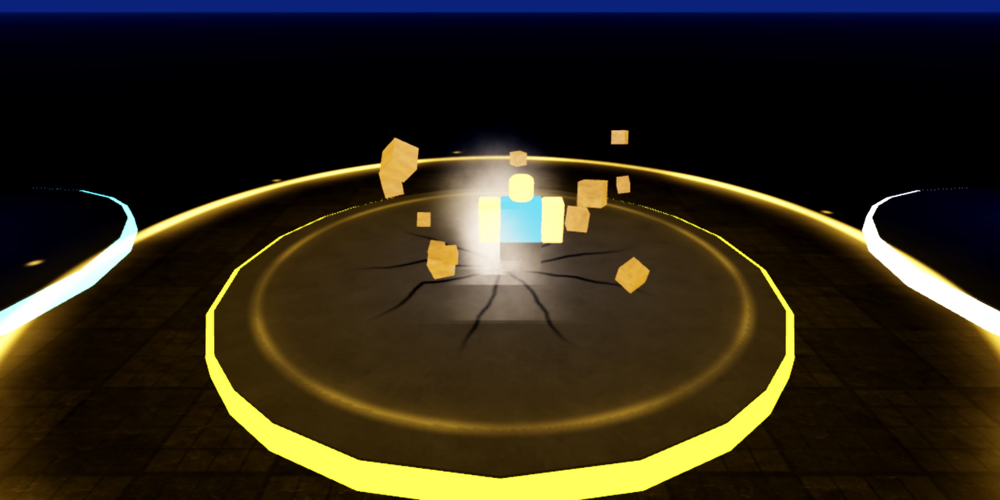
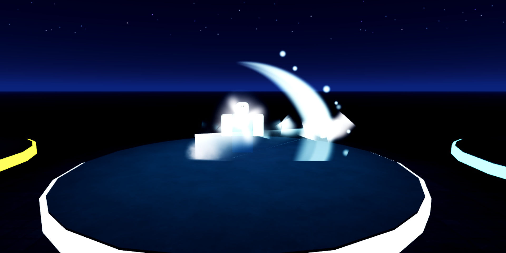
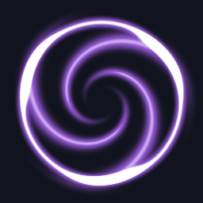
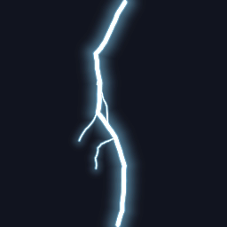

# #vfx-hiring: VFX artist

**Status:** ready to post.

## The post

Paste this into **#vfx-hiring** and attach the images below.

```
**[FOR HIRE] VFX Artist: Abilities, Hits, Auras, Portals**
Layered ability effects made for Roblox ParticleEmitters, with my own flipbook textures (no store packs).

**What I make:** ability VFX (fireball, lightning, dash, slam, charge, portal), hit sparks, auras, egg-hatch flashes, shockwaves
**Each ability is layered:** flash, flipbooks, shockwave, sparks, smoke, light, camera shake, debris
**Delivery:** a ModuleScript you call with one line (`VFX.Fireball(from, to)`), plus all textures uploaded or as PNGs

**Payment:** Robux or USD (PayPal) · per task or per project · DM for rates
**Contact:** ktfp  ·  **Roblox:** BizarreWasTaken (https://www.roblox.com/users/profile?username=BizarreWasTaken)  ·  **Portfolio:** [dawmo1.github.io](https://dawmo1.github.io)
```

## Images to attach

 
 
 
 

| File | What it shows |
|---|---|
| [`review/studio/vfx_portal.jpg`](../../review/studio/vfx_portal.jpg) | Portal, in Studio |
| [`review/studio/vfx_lightning.jpg`](../../review/studio/vfx_lightning.jpg) | Lightning strike, in Studio |
| [`review/studio/vfx_fireball.jpg`](../../review/studio/vfx_fireball.jpg) | Fireball, in Studio |
| [`review/studio/vfx_charge.jpg`](../../review/studio/vfx_charge.jpg) | Charge burst, in Studio |
| [`review/studio/vfx_slam.jpg`](../../review/studio/vfx_slam.jpg) | Ground slam, in Studio |
| [`review/studio/vfx_dash.jpg`](../../review/studio/vfx_dash.jpg) | Dash slash, in Studio |
| [`vfx/previews/portal_swirl.gif`](../../vfx/previews/portal_swirl.gif) | Portal swirl flipbook |
| [`vfx/previews/lightning_bolt.gif`](../../vfx/previews/lightning_bolt.gif) | Lightning flipbook |

## What's behind it

- `vfx/roblox/ActionVFX.lua`: the 6 abilities plus looping display versions for thumbnails
- `vfx/sheets/`: 13 4×4 flipbooks (white + alpha so Color tints them); `vfx/textures/`: beam, glow, crack, trail
- `tools/make_vfx.py` generates every sheet, so any effect can be re-timed or re-coloured
- All playable on the showcase page: `showcase/vfx-sfx.html`
