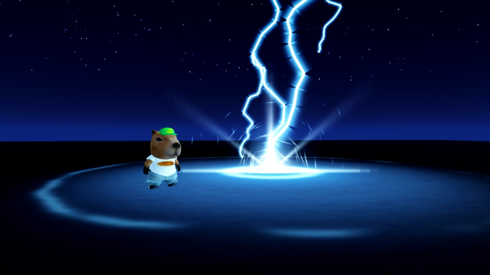
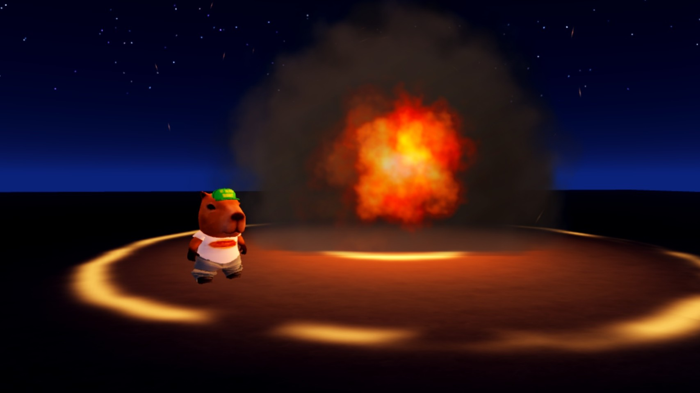
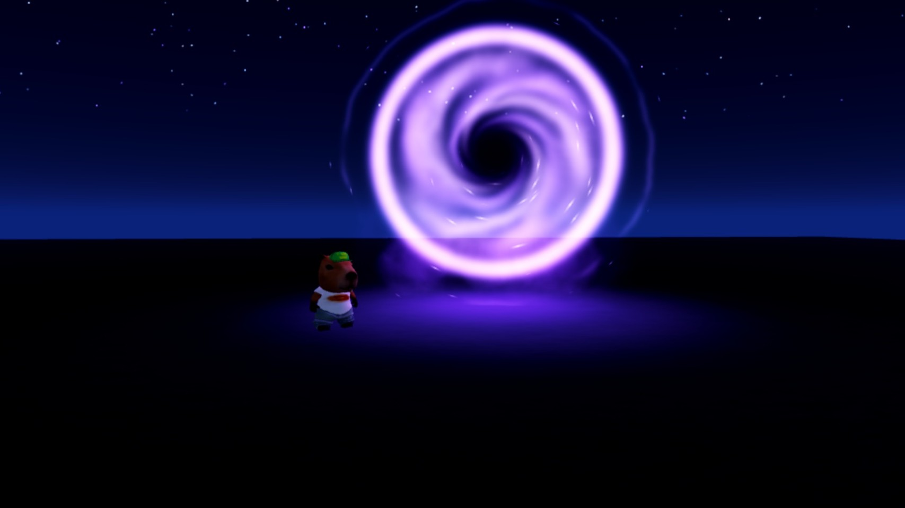
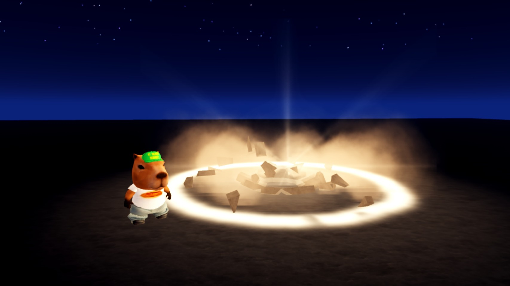
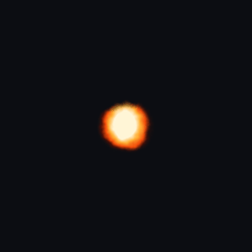
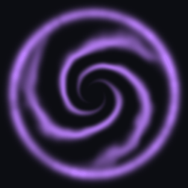
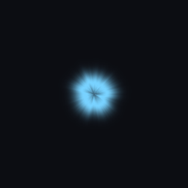

# #vfx-hiring: VFX artist

**Status:** ready to post.

## The post

Paste this into **#vfx-hiring** and attach the images below.

```
**[FOR HIRE] VFX Artist: Abilities, Impacts, Portals, Lightning**
Layered ability effects for Roblox, with my own procedurally generated flipbooks (no store packs).

**What I make:** ability VFX (lightning, fireballs, portals, slams, slashes), hit flashes, shockwaves, smoke and dust, auras
**How they're built:** colour-baked explosion and smoke flipbooks, segmented beam lightning with real forks, flipbook shock rings and sparks, dynamic lights and physical debris
**Delivery:** a ModuleScript you call with one line (`VFX.storm(cframe)`), plus every texture uploaded or as PNGs

**Payment:** Robux or USD (PayPal) · per task or per project · DM for rates
**Contact:** ktfp  ·  **Roblox:** BizarreWasTaken (https://www.roblox.com/users/profile?username=BizarreWasTaken)  ·  **Portfolio:** [dawmo1.github.io](https://dawmo1.github.io)
```

## Images to attach

 
 
  

| File | What it shows |
|---|---|
| [`site/img/vfx_storm.jpg`](../../site/img/vfx_storm.jpg) | Storm strike: forked bolts, glow pass, shock ring, sparks |
| [`site/img/vfx_inferno.jpg`](../../site/img/vfx_inferno.jpg) | Inferno blast: colour-baked fireball, rolling smoke, shock ring |
| [`site/img/vfx_portal.jpg`](../../site/img/vfx_portal.jpg) | Void portal: swirl flipbook, dark core, inward motes |
| [`site/img/vfx_slam.jpg`](../../site/img/vfx_slam.jpg) | Ground slam: dust wall, flying debris, shockwave |
| [`site/img/vfx_dash.jpg`](../../site/img/vfx_dash.jpg) | Blade dash: crossing slash arcs, impact flare |
| [`vfx/v2/previews/`](../../vfx/v2/previews/) | Every flipbook, animated |

## What's behind it

- `vfx/roblox/ShowcaseVFX.lua`: five abilities, each one function that builds its layers at a CFrame
- `tools/make_vfx2.py`: generates every texture from fractal noise (fire, smoke, explosion, shockwave, flare, slash, portal, sparks, beam glow), so any effect can be re-timed or recoloured
- `vfx/v2/`: the 1024px 4×4 sheets and their uploaded asset ids
