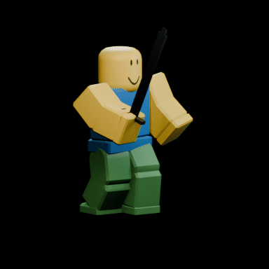
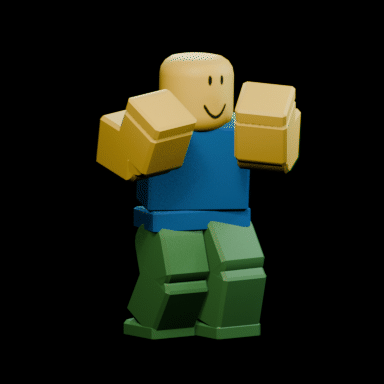
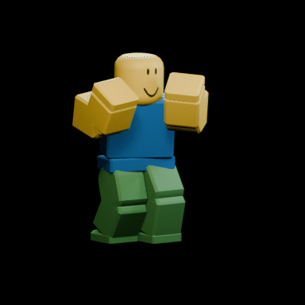
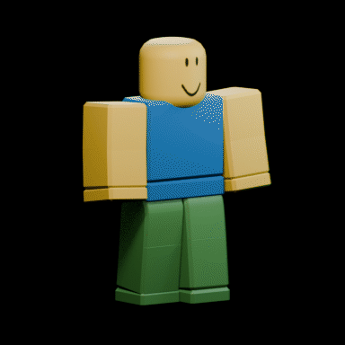
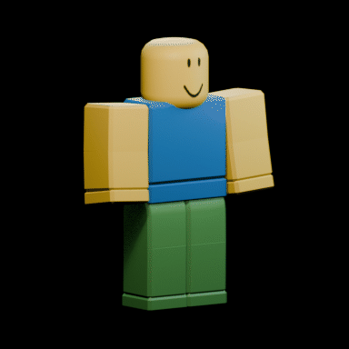
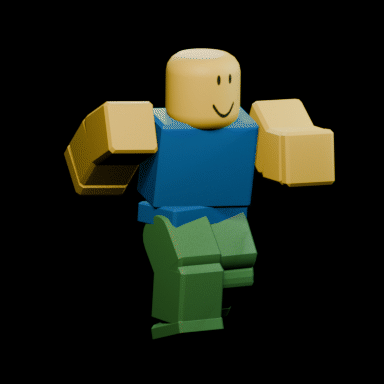

# Animation: ten R15 animations

Keyed in Blender on a classic R15 block rig at 30 fps, then played in Studio as KeyframeSequences.

  
  

| Clip | Frames | Loops | GIF |
|---|---|---|---|
| Sword combo | 44 | no | [gif](../../animation/previews/sword.gif) |
| Punch combo | 33 | no | [gif](../../animation/previews/punch.gif) |
| Front kick | 36 | no | [gif](../../animation/previews/kick.gif) |
| Block | 24 | no (ends holding) | [gif](../../animation/previews/block.gif) |
| Grenade throw | 32 | no | [gif](../../animation/previews/grenade.gif) |
| Revolver draw + fire | 36 | no | [gif](../../animation/previews/revolver.gif) |
| Run | 20 | yes | [gif](../../animation/previews/run.gif) |
| Jump | 30 | no | [gif](../../animation/previews/jump.gif) |
| Victory | 40 | no | [gif](../../animation/previews/victory.gif) |
| Idle | 60 | yes | [gif](../../animation/previews/idle.gif) |

## How it's built

- [`animation/animations.py`](../../animation/animations.py): every clip as a table of key poses, so retiming or reposing one is a small edit
- [`animation/pose_helper.py`](../../animation/pose_helper.py): poses are written as world-axis rotations, and a two-bone leg solver re-plants the feet every frame of a contact, so feet never slide
- Each clip passes an audit before export: Bezier curves only, exact loop seams, foot drift under 0.02 studs
- [`animation/noob_anim.blend`](../../animation/noob_anim.blend): the rig, all ten actions and the sword prop

## Into Studio

1. Blender exports [`animation/export/*.rbxanim`](../../animation/export/)
2. [`tools/rbxanim_to_luau.py`](../../tools/rbxanim_to_luau.py) converts them to compact tables in [`animation/studio/`](../../animation/studio/), dropping keys that linear playback already reproduces
3. [`animation/studio/Build.lua`](../../animation/studio/Build.lua) turns a table into a KeyframeSequence:

```lua
local build = require(ServerStorage.PortfolioAnimations.Build)
local seq = build("Sword", data, false, Enum.AnimationPriority.Action)
local anim = Instance.new("Animation")
anim.AnimationId = KeyframeSequenceProvider:RegisterKeyframeSequence(seq) -- or publish the sequence for an asset id
humanoid.Animator:LoadAnimation(anim):Play()
```
