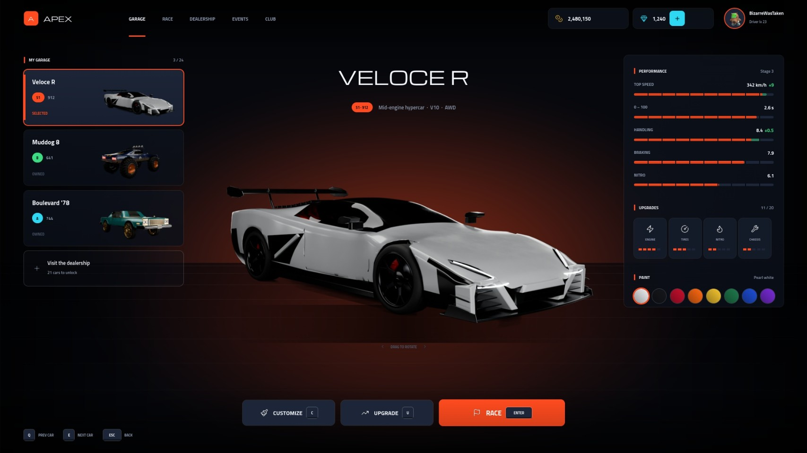
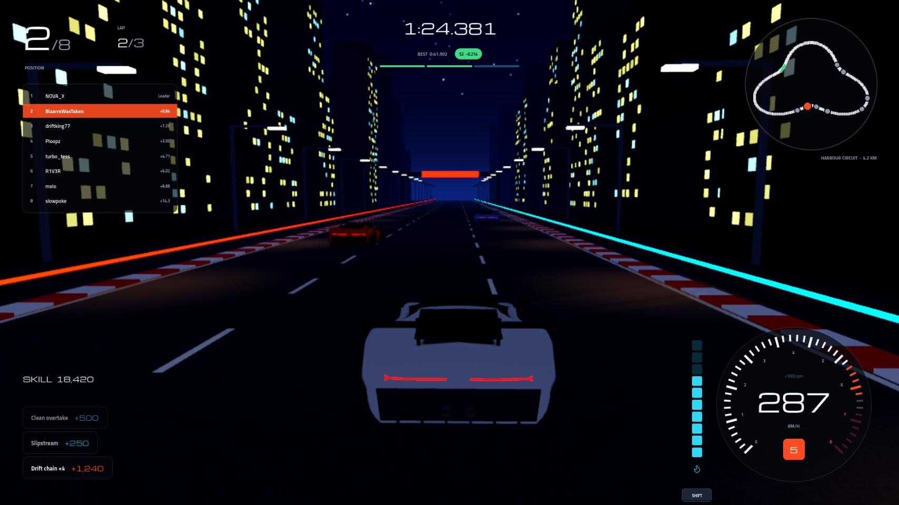
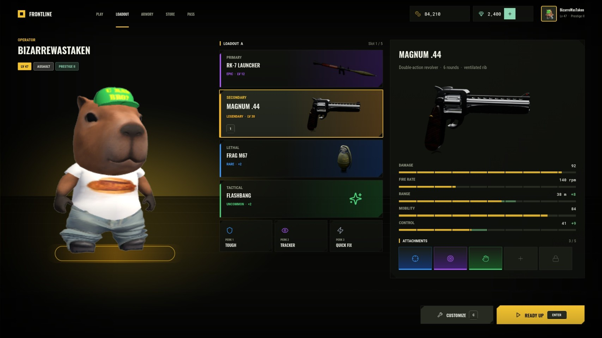
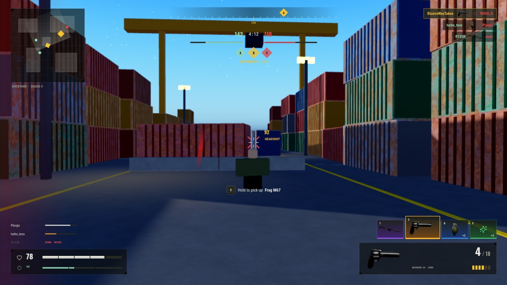
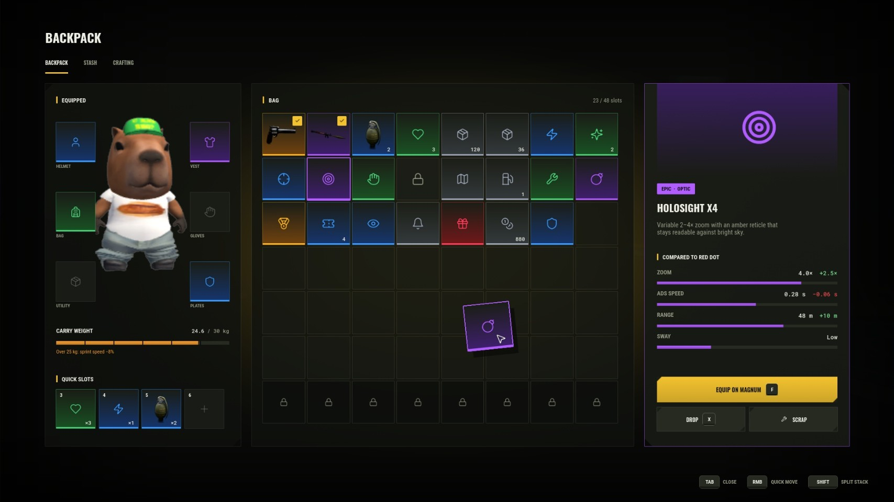
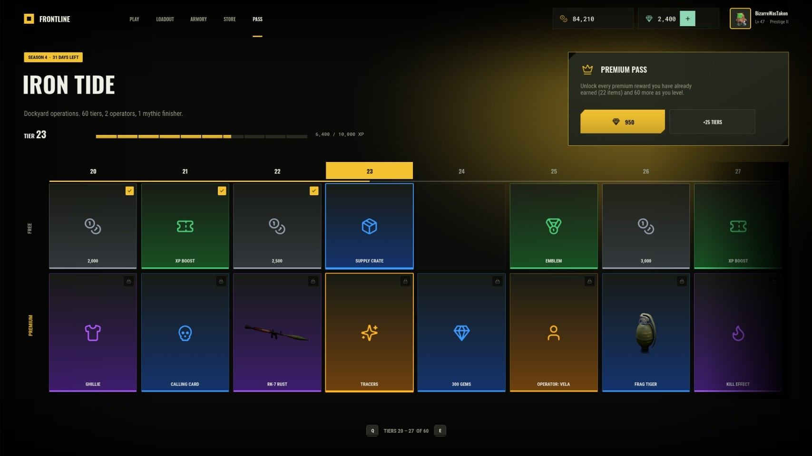

# Interface: ProKit and two UI kits

Thirteen game screens built in Studio as real ScreenGuis, all from one design system.

 
 
 

## The screens

| Kit | Screen | Source | Screenshot |
|---|---|---|---|
| APEX (racing) | Garage / car select | [`Garage.lua`](../../ui/roblox/apex/Garage.lua) | [jpg](../../site/img/ui_apex_garage.jpg) |
| | Race HUD | [`RaceHUD.lua`](../../ui/roblox/apex/RaceHUD.lua) | [jpg](../../site/img/ui_apex_racehud.jpg) |
| | Dealership | [`Dealership.lua`](../../ui/roblox/apex/Dealership.lua) | [jpg](../../site/img/ui_apex_dealership.jpg) |
| | Settings | [`Settings.lua`](../../ui/roblox/apex/Settings.lua) | [jpg](../../site/img/ui_apex_settings.jpg) |
| | Loading | [`Loading.lua`](../../ui/roblox/apex/Loading.lua) | [jpg](../../site/img/ui_apex_loading.jpg) |
| | Race results | [`Results.lua`](../../ui/roblox/apex/Results.lua) | [jpg](../../site/img/ui_apex_results.jpg) |
| FRONTLINE (shooter) | Loadout | [`Loadout.lua`](../../ui/roblox/frontline/Loadout.lua) | [jpg](../../site/img/ui_fl_loadout.jpg) |
| | Combat HUD | [`CombatHUD.lua`](../../ui/roblox/frontline/CombatHUD.lua) | [jpg](../../site/img/ui_fl_combathud.jpg) |
| | Backpack | [`Backpack.lua`](../../ui/roblox/frontline/Backpack.lua) | [jpg](../../site/img/ui_fl_backpack.jpg) |
| | Store | [`Store.lua`](../../ui/roblox/frontline/Store.lua) | [jpg](../../site/img/ui_fl_store.jpg) |
| | Battle pass | [`BattlePass.lua`](../../ui/roblox/frontline/BattlePass.lua) | [jpg](../../site/img/ui_fl_battlepass.jpg) |
| | Daily rewards | [`DailyRewards.lua`](../../ui/roblox/frontline/DailyRewards.lua) | [jpg](../../site/img/ui_fl_daily.jpg) |
| | Match end | [`MatchEnd.lua`](../../ui/roblox/frontline/MatchEnd.lua) | [jpg](../../site/img/ui_fl_matchend.jpg) |

## How it's built

- [`ui/roblox/ProKit.lua`](../../ui/roblox/ProKit.lua) (463 lines): two themes, panels, chamfered plates, buttons with key hints, stat bars with upgrade previews, tabs, toggles, sliders, segmented controls, rarity slots, the top bar
- Every screen is laid out on a 1920×1080 canvas and scaled to the player's screen with one `UIScale`, so spacing and strokes stay exact at any resolution
- Each screen module is one function: `require(screen)(ProKit, parentGui, props)` builds its ScreenGui
- [`ui/roblox/assets/`](../../ui/roblox/assets/): the icon atlas (Lucide, ISC licence), the item art rendered from the 3D models, and the uploaded asset ids
