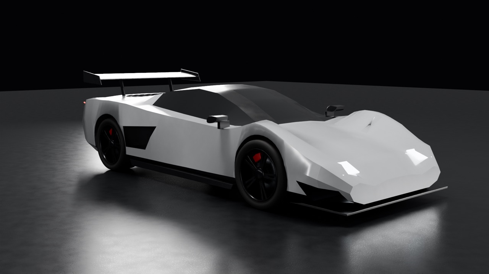
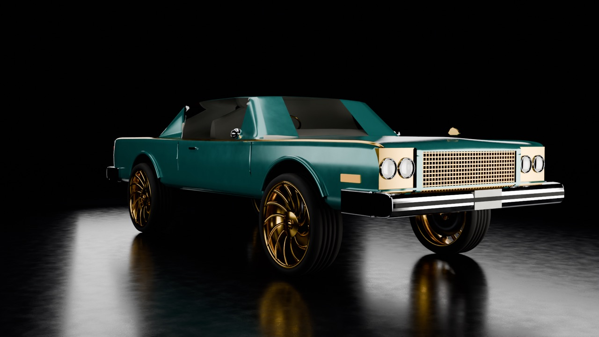
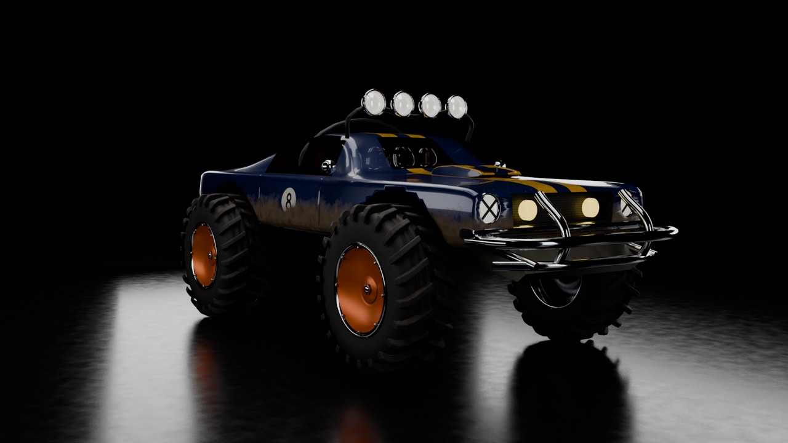
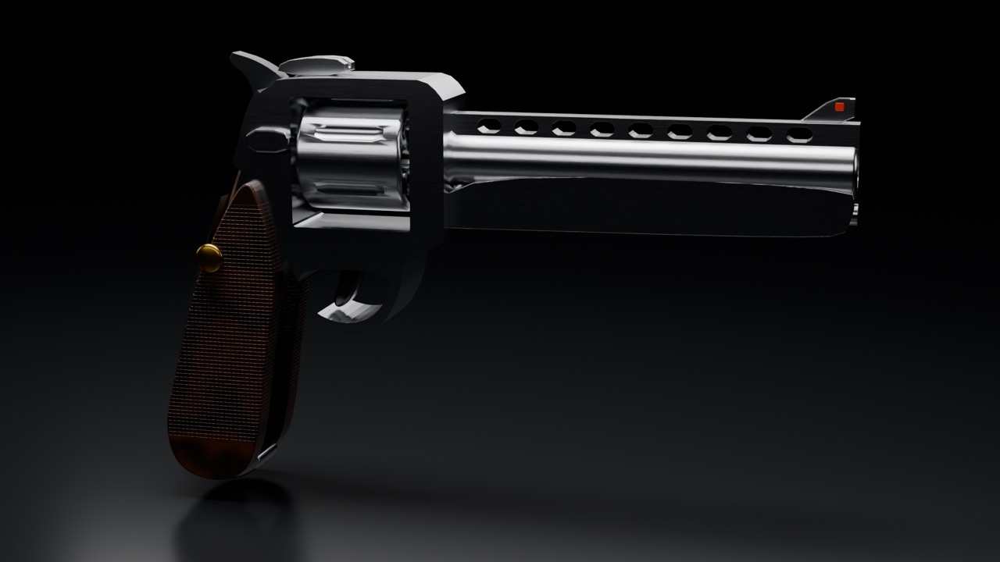
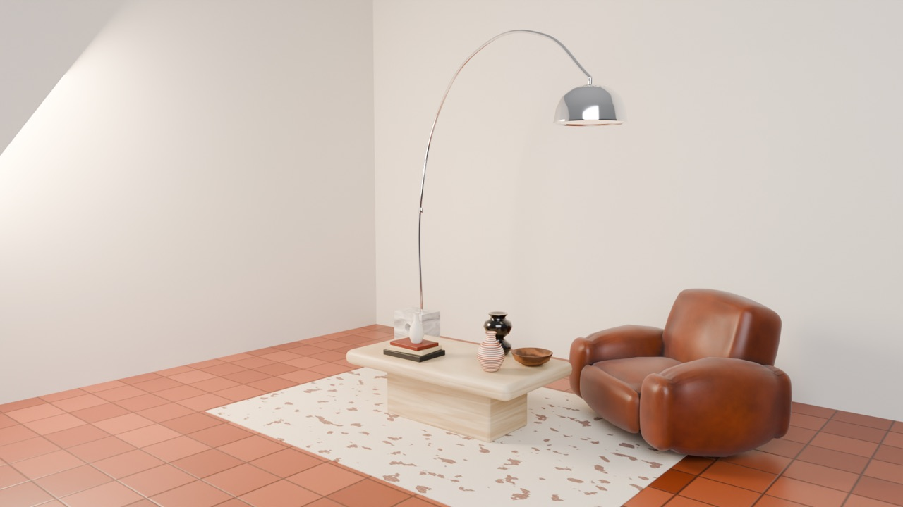
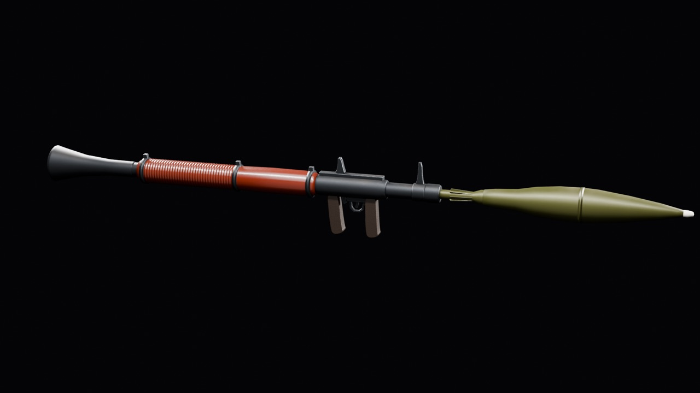

# Models: realistic, game-ready

Built in Blender at real-world scale. Each ships as one MeshPart under 20k triangles with baked colour, metal, roughness and normal maps for SurfaceAppearance.

 
 
 

| Model | Folder | Renders |
|---|---|---|
| Supercar | [`models/supercar/`](../../models/supercar/) | [hero](../../site/img/supercar_hero.jpg) · [front](../../site/img/supercar_front.jpg) · [rear](../../site/img/supercar_rear.jpg) |
| 70s land yacht | [`models/donk/`](../../models/donk/) | [hero](../../site/img/donk_hero.jpg) · [side](../../site/img/donk_side.jpg) |
| Mud runner | [`models/mudrunner/`](../../models/mudrunner/) | [hero](../../site/img/mudrunner_hero.jpg) · [rear](../../site/img/mudrunner_rear.jpg) |
| Revolver | [`models/revolver/`](../../models/revolver/) | [hero](../../site/img/revolver_hero.jpg) · [detail](../../site/img/revolver_detail.jpg) |
| Rocket launcher | [`models/launcher/`](../../models/launcher/) | [hero](../../site/img/launcher_hero.jpg) · [detail](../../site/img/launcher_detail.jpg) |
| Grenade | [`models/grenade/`](../../models/grenade/) | [hero](../../site/img/grenade_hero.jpg) · [detail](../../site/img/grenade_detail.jpg) |
| Living-room set | [`models/decor/`](../../models/decor/) | [hero](../../site/img/decor_hero.jpg) · [table](../../site/img/decor_table.jpg) |
| Lounge chair | [`models/lounge_chair/`](../../models/lounge_chair/) | [hero](../../site/img/lounge_chair_hero.jpg) · [detail](../../site/img/lounge_chair_detail.jpg) |
| Football | [`models/football/`](../../models/football/) | [hero](../../site/img/football_hero.jpg) |
| Carbine | [`models/carbine/`](../../models/carbine/) | [hero](../../site/img/carbine_hero.jpg) · [detail](../../site/img/carbine_detail.jpg) |
| Greatsword | [`models/greatsword/`](../../models/greatsword/) | [hero](../../site/img/greatsword_hero.jpg) · [detail](../../site/img/greatsword_detail.jpg) |
| Racing kart | [`models/kart/`](../../models/kart/) | [hero](../../site/img/kart_hero.jpg) · [detail](../../site/img/kart_detail.jpg) |
| Loot chest | [`models/chest/`](../../models/chest/) | [open](../../site/img/chest_open_hero.jpg) · [closed](../../site/img/chest_closed_hero.jpg) |
| Blaster | [`models/blaster/`](../../models/blaster/) | [hero](../../site/img/blaster_hero.jpg) · [detail](../../site/img/blaster_detail.jpg) |

## Source

- `models/<name>/`: the `.fbx` and its texture maps, ready for Studio import
- [`models/portfolio_models_v2.blend`](../../models/portfolio_models_v2.blend): vehicles, weapons and furniture; [`models/portfolio_models_pbr.blend`](../../models/portfolio_models_pbr.blend): the first PBR batch
- [`assets/turntables/`](../../assets/turntables/): turntable GIFs
