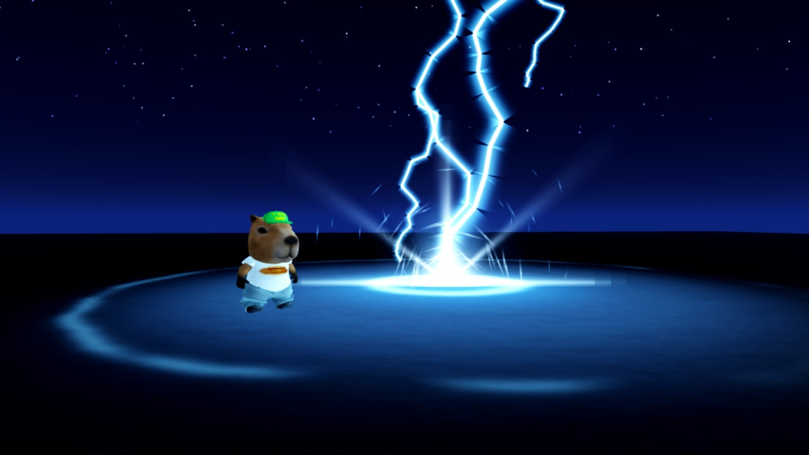
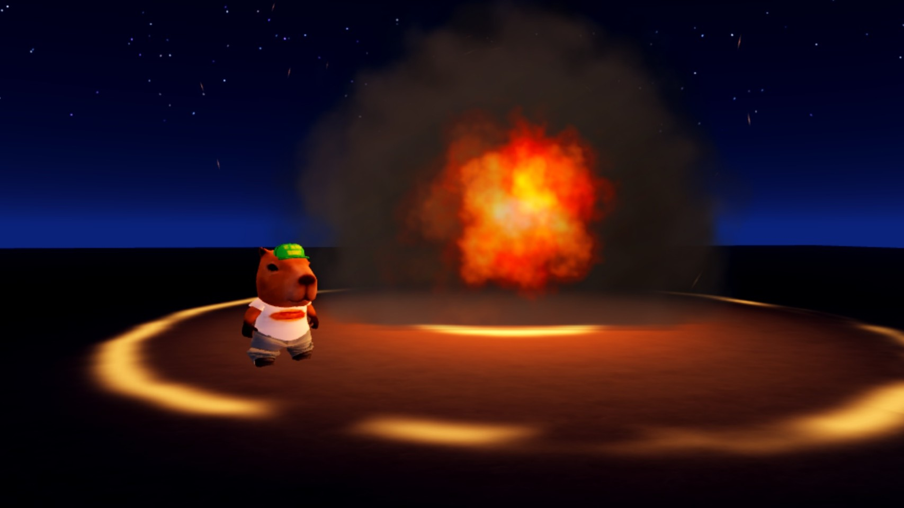
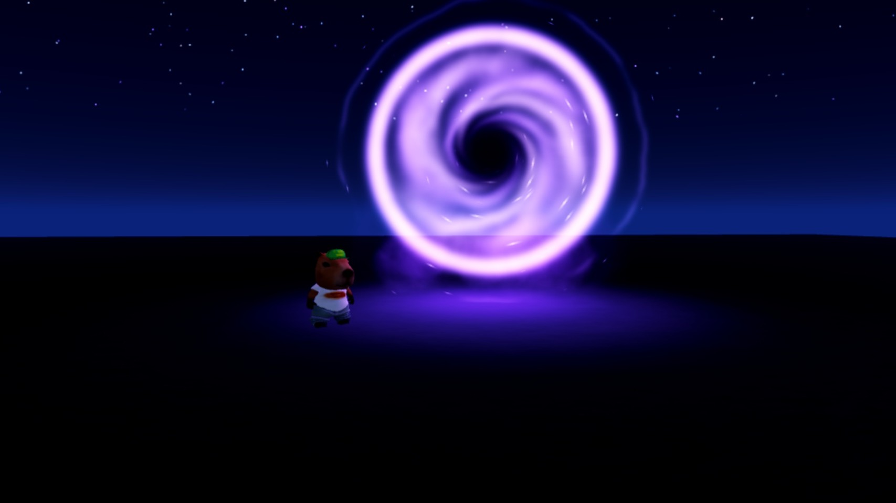
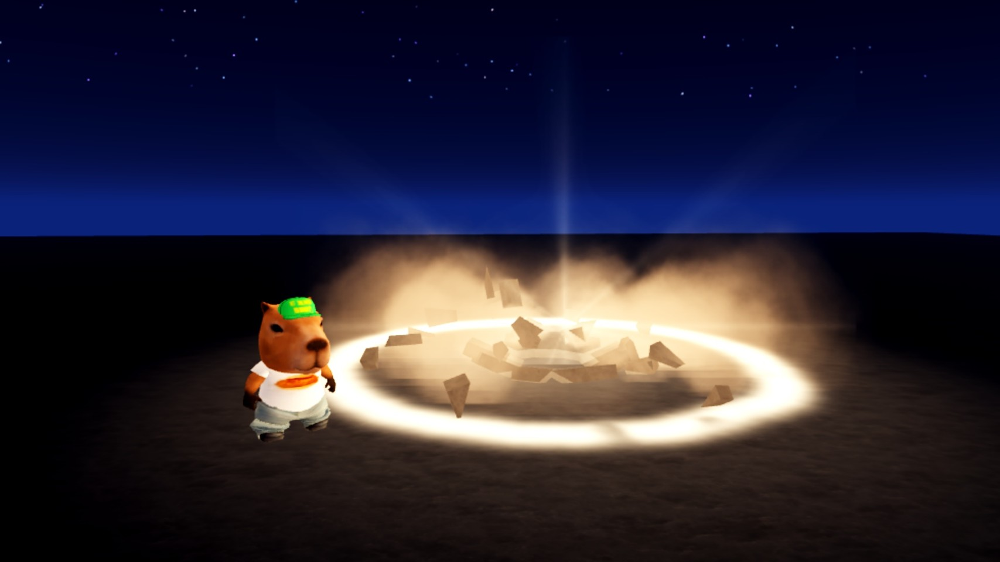
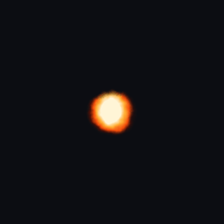
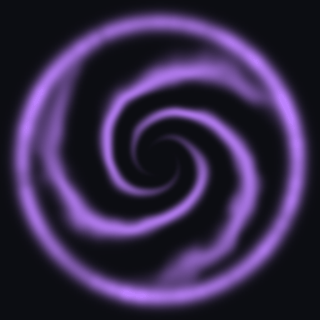

# VFX: five layered abilities

Each ability is one function that builds its layers (flipbook particles, beams, lights, debris) at a CFrame.

 
 
  

## Use it

```lua
local VFX = require(ReplicatedStorage.ShowcaseVFX)
local fx = VFX.storm(target.CFrame)   -- also: inferno, portal, dash, slam
Debris:AddItem(fx, 4)
```

| Ability | What's layered | Screenshot |
|---|---|---|
| `storm` | Segmented beam bolts with forks, glow pass, shock ring, sparks | [jpg](../../site/img/vfx_storm.jpg) |
| `inferno` | Colour-baked fireball flipbook, rolling smoke, shock ring | [jpg](../../site/img/vfx_inferno.jpg) |
| `portal` | Swirl flipbook, dark core, inward motes | [jpg](../../site/img/vfx_portal.jpg) |
| `dash` | Crossing slash arcs, impact flare | [jpg](../../site/img/vfx_dash.jpg) |
| `slam` | Dust wall, flying debris, shockwave | [jpg](../../site/img/vfx_slam.jpg) |

## Source

- [`vfx/roblox/ShowcaseVFX.lua`](../../vfx/roblox/ShowcaseVFX.lua) (261 lines): the five abilities
- [`vfx/roblox/ActionVFX.lua`](../../vfx/roblox/ActionVFX.lua) (365 lines): the earlier ability set, emitter builder and camera shake
- [`tools/make_vfx2.py`](../../tools/make_vfx2.py): generates every texture from fractal noise (fire, smoke, explosion, shockwave, flare, slash, portal, sparks, beam glow)
- [`vfx/v2/`](../../vfx/v2/): the 4×4 flipbook sheets, their [previews](../../vfx/v2/previews/) and uploaded asset ids
